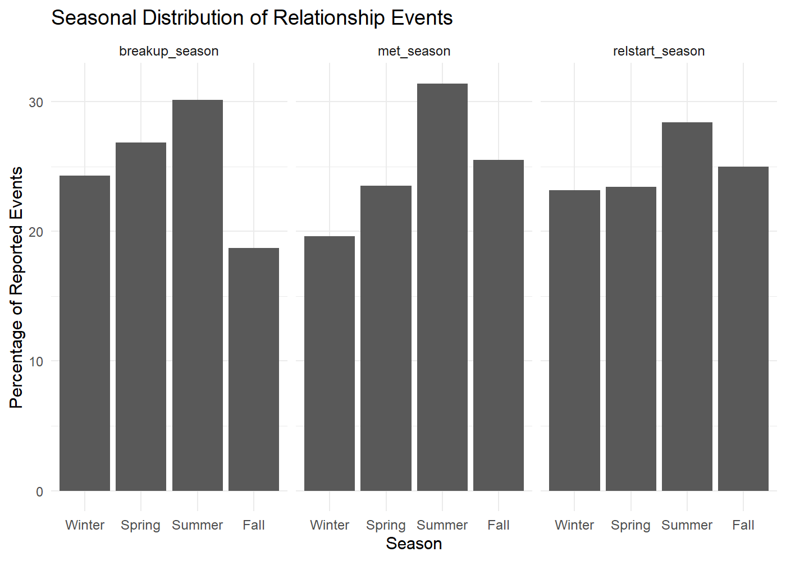

# EDA
Your name

Dataset I’m interested in exploring:

- [How Couples Meet and Stay Together 2017 (HCMST
  2017)](https://data.stanford.edu/hcmst2017)

- [User
  Guide](https://stacks.stanford.edu/file/druid:tq903pj6286/HCMST%202017-%202022%20user%27s%20guide%20v2.3.pdf)

What I want to explore:

- How real is “Cuffing Season,” how does it differ across age groups?

## Plots I want to make:

Revised goal: - The final 2 charts in the crossword article looked at
very specific words to explore who was mentioned in clues to get those
words - I would like to do something similar where I hone in on part of
the data and visualize an aspect of it that reinforces the story

``` r
library(tidyverse)
```

    ── Attaching core tidyverse packages ──────────────────────── tidyverse 2.0.0 ──
    ✔ dplyr     1.2.1     ✔ readr     2.2.0
    ✔ forcats   1.0.1     ✔ stringr   1.6.0
    ✔ ggplot2   4.0.3     ✔ tibble    3.3.1
    ✔ lubridate 1.9.5     ✔ tidyr     1.3.2
    ✔ purrr     1.2.2     
    ── Conflicts ────────────────────────────────────────── tidyverse_conflicts() ──
    ✖ dplyr::filter() masks stats::filter()
    ✖ dplyr::lag()    masks stats::lag()
    ℹ Use the conflicted package (<http://conflicted.r-lib.org/>) to force all conflicts to become errors

``` r
load("../data/HCMST 2017 to 2022 small public version 2.2.rdata")

hcmst <- `HCMST small public version 2.2`
?labelled::to_labelled
```

    starting httpd help server ... done

``` r
core_variables <- c(
  "caseid_new", # respondant identifier
  "w1_partnership_status", # relationship status in wave 1
  "w1_weight_combo", # analytic weight 
  "w1_ppage", # age in years at wave 1
  "w1_ppagecat", # 7 age category at wave 1
  "w1_ppagect4", # 4 age category
  "w1_age_when_met", # calculated age when partners met
  "w1_q21a_year", # year respondant met partner
  "w1_q21a_month", # month respondant met partner
  "w1_year_fraction_met", # decimal year representation of meeting date
  "w1_q21b_year", # year relationship began
  "w1_q21b_month", # month relationship began
  "w1_year_fraction_relstart", # decimal year representation of relationship start
  "w1_time_from_met_to_rel" # met date to relationship start date in years
)

how_met_variables <- "w1_q24"
breakup_variables <- "w1_q21e"

cuffing_data <- hcmst |> 
  select(any_of(core_variables),
         contains(how_met_variables),
         contains(breakup_variables)) |> 
  mutate(across(c("w1_partnership_status", "w1_ppagecat","w1_ppagect4"),haven::as_factor),
         across(contains(how_met_variables),haven::as_factor)
  ) |> 
  mutate(w1_year_fraction_breakup = w1_q21e_year+((w1_q21e_month-0.5)/12)) |> # this creates a year fraction for breakup date using the same formula the survey uses for relstart date
  mutate(relationship_length = w1_year_fraction_breakup - w1_year_fraction_relstart) |> # creates a relationship length variable
  mutate(
    w1_age_at_relstart = w1_ppage - (2017 - w1_q21b_year)) |> 
  mutate(across(c(w1_ppage, w1_age_when_met, w1_age_at_relstart),
      ~ cut(
        .x,
        breaks = c(18, 25, 35, 45, 65, Inf),
        labels = c("18-24", "25-34", "35-44", "45-64", "65+"),
        right = FALSE
      ),
      .names = "{.col}_cat")) |> 
  mutate(
  relstart_season = case_when(
    w1_q21b_month %in% c(12, 1, 2) ~ "Winter",
    w1_q21b_month %in% c(3, 4, 5)  ~ "Spring",
    w1_q21b_month %in% c(6, 7, 8)  ~ "Summer",
    w1_q21b_month %in% c(9, 10, 11) ~ "Fall",
    TRUE ~ NA_character_
  ),
  relstart_season = factor(
    relstart_season,
    levels = c("Winter", "Spring", "Summer", "Fall")
  ),
  met_season = case_when(
    w1_q21a_month %in% c(12, 1, 2) ~ "Winter",
    w1_q21a_month %in% c(3, 4, 5)  ~ "Spring",
    w1_q21a_month %in% c(6, 7, 8)  ~ "Summer",
    w1_q21a_month %in% c(9, 10, 11) ~ "Fall",
    TRUE ~ NA_character_
  ),
  met_season = factor(
    met_season,
    levels = c("Winter", "Spring", "Summer", "Fall")
  ),
  breakup_season = case_when(
    w1_q21e_month %in% c(12, 1, 2) ~ "Winter",
    w1_q21e_month %in% c(3, 4, 5)  ~ "Spring",
    w1_q21e_month %in% c(6, 7, 8)  ~ "Summer",
    w1_q21e_month %in% c(9, 10, 11) ~ "Fall",
    TRUE ~ NA_character_
  ),
  breakup_season = factor(
    breakup_season,
    levels = c("Winter", "Spring", "Summer", "Fall")
  )
)

summary(hcmst$w1_ppage)
```

       Min. 1st Qu.  Median    Mean 3rd Qu.    Max. 
      18.00   34.00   50.00   48.79   62.00   93.00 

``` r
summary(hcmst$w1_year_fraction_relstart)
```

       Min. 1st Qu.  Median    Mean 3rd Qu.    Max.     NAs 
       1942    1984    2000    1996    2011    2018     234 

``` r
summary(cuffing_data$w1_age_when_met)
```

       Min. 1st Qu.  Median    Mean 3rd Qu.    Max.     NAs 
       0.00   18.00   23.00   26.65   32.00   84.00     169 

``` r
summary(cuffing_data$w1_age_at_relstart)
```

       Min. 1st Qu.  Median    Mean 3rd Qu.    Max.     NAs 
       0.00   20.00   25.00   28.18   34.00   84.00     234 

``` r
summary(cuffing_data$w1_q21e_year)
```

       Min. 1st Qu.  Median    Mean 3rd Qu.    Max.     NAs 
       1975    2002    2012    2008    2016    2017    3100 

``` r
sum(!is.na(cuffing_data$w1_q21e_year))
```

    [1] 410

``` r
cuffing_design <- cuffing_data |>
  srvyr::as_survey_design(
    ids = 1,
    weights = w1_weight_combo
  )
```

``` r
library(patchwork)
# this is what the histogram looks like before taking weights into account
ggplot(cuffing_data, aes(x = w1_q21b_month, fill = w1_age_at_relstart_cat)) +
  geom_bar()
```

    Warning: Removed 209 rows containing non-finite outside the scale range
    (`stat_count()`).


``` r
# this is what the seasonal chart looks like before taking weights into account
ggplot(cuffing_data, aes(x = met_season, fill = w1_age_at_relstart_cat)) +
         geom_bar()
```


``` r
# only looking at the 18-24 category
all_age_met <- ggplot(cuffing_data, aes(x = met_season)) +
  geom_bar()  +
  ggtitle("Relationship Meet Date by Season, All Ages")

all_age_relstart <- ggplot(cuffing_data, aes(x = relstart_season)) +
  geom_bar() +
  ggtitle("Relationship Start by Season, All Ages")

# only looking at the 18-24 category
college_age_met <- ggplot(subset(cuffing_data, w1_age_at_relstart_cat == "18-24"), aes(x = met_season)) +
  geom_bar()  +
  ggtitle("Relationship Meet Date by Season, 18-24")

college_age_relstart <- ggplot(subset(cuffing_data, w1_age_at_relstart_cat == "18-24"), aes(x = relstart_season)) +
  geom_bar() +
  ggtitle("Relationship Start by Season, 18-24")

# plot these 4 to compare

(all_age_met + college_age_met) / (all_age_relstart + college_age_relstart)
```


``` r
ggplot(cuffing_data, aes(x = factor(w1_q21b_month), y = relationship_length)) +
  geom_boxplot()
```

    Warning: Removed 3124 rows containing non-finite outside the scale range
    (`stat_boxplot()`).


``` r
# plotting relationship 


# Use Waffle Package to make a seperate chart for each age group, and have the values be the seasons by counts
# of times that couples began their relationship then.
  # this would use the waffle plot + faceting
```

``` r
cuffing_data |>
  summarise(
    across(
      c(breakup_season, met_season, relstart_season),
      ~ sum(!is.na(.x))
    )
  )
```

      breakup_season met_season relstart_season
    1            395       3350            3301

``` r
table(cuffing_data$met_season,
      cuffing_data$relstart_season,
      useNA = "ifany")
```

            
             Winter Spring Summer Fall <NA>
      Winter    341    182     79   44   11
      Spring     68    393    219   89   18
      Summer    127     89    544  269   23
      Fall      227    107     91  422    7
      <NA>        2      3      4    1  150

``` r
table(cuffing_data$met_season,
      cuffing_data$breakup_season,
      useNA = "ifany")
```

            
             Winter Spring Summer Fall <NA>
      Winter     14     36     24   12  571
      Spring     29     24     25   15  694
      Summer     26     28     38   29  931
      Fall       26     18     32   17  761
      <NA>        1      0      0    1  158

``` r
seasonal_data <- cuffing_data |>
  select(
    caseid_new,
    ends_with("_season")
  ) |>
  pivot_longer(
    cols = -caseid_new,
    names_to = "event",
    values_to = "season"
  ) |>
  mutate(
    event = recode(
      event,
      w1_q21a_month_season = "Met partner",
      w1_q21b_month_season = "Relationship began",
      w1_q21e_month_season = "Relationship ended"
    ),
    season = factor(
      season,
      levels = c("Winter", "Spring", "Summer", "Fall")
    )
  )

seasonal_summary <- seasonal_data |>
  filter(!is.na(season)) |>
  group_by(event, season) |>
  summarise(
    n = n(),
    .groups = "drop"
  ) |>
  group_by(event) |>
  mutate(
    percentage = n / sum(n) * 100
  )

ggplot(
  seasonal_summary,
  aes(x = season, y = percentage)
) +
  geom_col() +
  facet_wrap(~event) +
  labs(
    title = "Seasonal Distribution of Relationship Events",
    x = "Season",
    y = "Percentage of Reported Events"
  ) +
  theme_minimal()
```


