# EDA
Connor Mahone

Dataset I’m interested in exploring:

- [How Couples Meet and Stay Together 2017 (HCMST
  2017)](https://data.stanford.edu/hcmst2017)

- [User
  Guide](https://stacks.stanford.edu/file/druid:tq903pj6286/HCMST%202017-%202022%20user%27s%20guide%20v2.3.pdf)

What I want to explore:

- How real is “Cuffing Season,” how does it differ across age groups?

Plots I want to make: - STRONG OPTION NOW: Use ggmosaic!!!!! - Maybe use
ggalluvial to map relationship met, to start, to breakup month? - Use
ggridges to plot month of relstart by age group???

Revised goal: - The final 2 charts in the crossword article looked at
very specific words to explore who was mentioned in clues to get those
words - I would like to do something similar where I hone in on part of
the data and visualize an aspect of it that reinforces the story - As my
focus graph I can explore what the two bumps are in the 65+ range

I’m not sure where to put this note yet but I think it’ll be interesting
to include somewhere: When I initially classed each row into an age
category based on the relationship start date I didn’t make an under 18
category because none of the respondants were under 18, but I didn’t
even think about the fact that a huge amount of respondants may have
been 18 when filling out the survey but under 18 when their relationship
began. I added that in and all the NAs disappeared.

``` r
library(tidyverse)
```

    ── Attaching core tidyverse packages ──────────────────────── tidyverse 2.0.0 ──
    ✔ dplyr     1.2.1     ✔ readr     2.2.0
    ✔ forcats   1.0.1     ✔ stringr   1.6.0
    ✔ ggplot2   4.0.3     ✔ tibble    3.3.1
    ✔ lubridate 1.9.5     ✔ tidyr     1.3.2
    ✔ purrr     1.2.2     
    ── Conflicts ────────────────────────────────────────── tidyverse_conflicts() ──
    ✖ dplyr::filter() masks stats::filter()
    ✖ dplyr::lag()    masks stats::lag()
    ℹ Use the conflicted package (<http://conflicted.r-lib.org/>) to force all conflicts to become errors

``` r
library(srvyr)
```


    Attaching package: 'srvyr'

    The following object is masked from 'package:stats':

        filter

``` r
library(waffle)

load("../data/HCMST 2017 to 2022 small public version 2.2.rdata")

hcmst <- `HCMST small public version 2.2`
summary(hcmst)
```

       caseid_new        w3_Weight      w3_Weight_LGB    w3_combo_weight  
     Min.   :  53001   Min.   :0.2825   Min.   :0.1187   Min.   :0.04178  
     1st Qu.:1825512   1st Qu.:0.5910   1st Qu.:0.2703   1st Qu.:0.57024  
     Median :2282692   Median :0.8160   Median :0.5949   Median :0.83313  
     Mean   :2181074   Mean   :1.0000   Mean   :1.0000   Mean   :1.00000  
     3rd Qu.:2759545   3rd Qu.:1.1849   3rd Qu.:1.3335   3rd Qu.:1.21130  
     Max.   :2972135   Max.   :4.1723   Max.   :6.1952   Max.   :4.67340  
                       NAs    :1971     NAs    :3261     NAs    :1788     
     w3_attrition_adj_weight w2_weight_genpop w2_weight_LGB    w2_combo_weight  
     Min.   : 0.0269         Min.   :0.2115   Min.   :0.1049   Min.   :0.03317  
     1st Qu.: 0.4443         1st Qu.:0.6412   1st Qu.:0.3579   1st Qu.:0.60282  
     Median : 0.7042         Median :0.8563   Median :0.6493   Median :0.86512  
     Mean   : 1.0000         Mean   :1.0000   Mean   :1.0000   Mean   :1.00000  
     3rd Qu.: 1.1670         3rd Qu.:1.2125   3rd Qu.:1.2576   3rd Qu.:1.25541  
     Max.   :14.6383         Max.   :4.0300   Max.   :6.2092   Max.   :4.57419  
     NAs    :1788            NAs    :1644     NAs    :3186     NAs    :1403     
     w2_attrition_adj_weights w1_weight_combo   w1_weight_combo_freqwt
     Min.   :0.02444          Min.   :0.05897   Min.   :  4093        
     1st Qu.:0.50519          1st Qu.:0.81861   1st Qu.: 56820        
     Median :0.75486          Median :1.01271   Median : 70292        
     Mean   :1.00000          Mean   :1.00000   Mean   : 69410        
     3rd Qu.:1.23372          3rd Qu.:1.24508   3rd Qu.: 86421        
     Max.   :7.07705          Max.   :3.11083   Max.   :215923        
     NAs    :1403                                                     
     w3_xpartner_type w3_xlast_contact_year   w3_xcohab      w3_xsamesex   
     Min.   :1.000    Min.   :2017          Min.   :1.000   Min.   :1.000  
     1st Qu.:1.000    1st Qu.:2017          1st Qu.:1.000   1st Qu.:2.000  
     Median :1.000    Median :2020          Median :1.000   Median :2.000  
     Mean   :1.646    Mean   :2019          Mean   :1.136   Mean   :1.921  
     3rd Qu.:2.000    3rd Qu.:2020          3rd Qu.:1.000   3rd Qu.:2.000  
     Max.   :4.000    Max.   :2020          Max.   :2.000   Max.   :2.000  
                                            NAs    :715     NAs    :515    
     w3_xlast_contact_mo w3_xnamep_present  w3_duration       w3_gen_pop_sample
     Min.   : 7.000      Min.   :0.000     Min.   :   0.580   Min.   :0.0000   
     1st Qu.: 7.000      1st Qu.:1.000     1st Qu.:   5.240   1st Qu.:1.0000   
     Median : 9.000      Median :1.000     Median :   7.655   Median :1.0000   
     Mean   : 8.224      Mean   :0.853     Mean   :  14.703   Mean   :0.8937   
     3rd Qu.: 9.000      3rd Qu.:1.000     3rd Qu.:  12.095   3rd Qu.:1.0000   
     Max.   :10.000      Max.   :1.000     Max.   :1143.960   Max.   :1.0000   
                                           NAs    :1788       NAs    :1788     
        w3_ppage      w3_ppagecat     w3_ppagect4      w3_ppeduc    
     Min.   :22.00   Min.   :1.000   Min.   :1.000   Min.   : 1.00  
     1st Qu.:43.00   1st Qu.:3.000   1st Qu.:2.000   1st Qu.: 9.00  
     Median :58.00   Median :5.000   Median :3.000   Median :11.00  
     Mean   :55.49   Mean   :4.574   Mean   :3.122   Mean   :10.75  
     3rd Qu.:68.00   3rd Qu.:6.000   3rd Qu.:4.000   3rd Qu.:12.00  
     Max.   :98.00   Max.   :7.000   Max.   :4.000   Max.   :14.00  
     NAs    :1788    NAs    :1788    NAs    :1788    NAs    :1788   
      w3_ppeducat      w3_ppethm      w3_ppgender     w3_pphhhead    
     Min.   :1.000   Min.   :1.000   Min.   :1.000   Min.   :0.0000  
     1st Qu.:2.000   1st Qu.:1.000   1st Qu.:1.000   1st Qu.:1.0000  
     Median :3.000   Median :1.000   Median :1.000   Median :1.0000  
     Mean   :3.085   Mean   :1.555   Mean   :1.449   Mean   :0.8548  
     3rd Qu.:4.000   3rd Qu.:1.000   3rd Qu.:2.000   3rd Qu.:1.0000  
     Max.   :4.000   Max.   :5.000   Max.   :2.000   Max.   :1.0000  
     NAs    :1788    NAs    :1788    NAs    :1788    NAs    :1788    
      w3_pphhsize       w3_pphouse     w3_ppincimp    w3_real_inc    
     Min.   : 1.000   Min.   :1.000   Min.   : 1.0   Min.   :  2500  
     1st Qu.: 2.000   1st Qu.:1.000   1st Qu.:11.0   1st Qu.: 45000  
     Median : 2.000   Median :1.000   Median :14.0   Median : 80000  
     Mean   : 2.399   Mean   :1.431   Mean   :13.6   Mean   : 98612  
     3rd Qu.: 3.000   3rd Qu.:1.000   3rd Qu.:17.0   3rd Qu.:137500  
     Max.   :12.000   Max.   :5.000   Max.   :21.0   Max.   :300000  
     NAs    :1788     NAs    :1788    NAs    :1788   NAs    :1788    
     w3_log_real_inc    w3_ppmarit     w3_ppmsacat      w3_PPREG4    
     Min.   : 7.766   Min.   :1.000   Min.   :0.000   Min.   :1.000  
     1st Qu.:10.656   1st Qu.:1.000   1st Qu.:1.000   1st Qu.:2.000  
     Median :11.232   Median :1.000   Median :1.000   Median :3.000  
     Mean   :11.116   Mean   :2.196   Mean   :0.863   Mean   :2.624  
     3rd Qu.:11.773   3rd Qu.:3.000   3rd Qu.:1.000   3rd Qu.:3.000  
     Max.   :12.553   Max.   :6.000   Max.   :1.000   Max.   :4.000  
     NAs    :1788     NAs    :1788    NAs    :1788    NAs    :1788   
       w3_ppreg9       w3_pprent        w3_PPT01          w3_PPT25     
     Min.   :1.000   Min.   :1.000   Min.   :0.00000   Min.   :0.0000  
     1st Qu.:3.000   1st Qu.:1.000   1st Qu.:0.00000   1st Qu.:0.0000  
     Median :5.000   Median :1.000   Median :0.00000   Median :0.0000  
     Mean   :5.069   Mean   :1.199   Mean   :0.03833   Mean   :0.0633  
     3rd Qu.:7.000   3rd Qu.:1.000   3rd Qu.:0.00000   3rd Qu.:0.0000  
     Max.   :9.000   Max.   :3.000   Max.   :2.00000   Max.   :2.0000  
     NAs    :1788    NAs    :1788    NAs    :1788      NAs    :1788    
       w3_PPT612      w3_total_kids_lt13   w3_PPT1317        w3_PPT18OV    
     Min.   :0.0000   Min.   :0.0000     Min.   :0.00000   Min.   : 1.000  
     1st Qu.:0.0000   1st Qu.:0.0000     1st Qu.:0.00000   1st Qu.: 2.000  
     Median :0.0000   Median :0.0000     Median :0.00000   Median : 2.000  
     Mean   :0.1365   Mean   :0.2381     Mean   :0.09408   Mean   : 2.067  
     3rd Qu.:0.0000   3rd Qu.:0.0000     3rd Qu.:0.00000   3rd Qu.: 2.000  
     Max.   :6.0000   Max.   :8.0000     Max.   :3.00000   Max.   :12.000  
     NAs    :1788     NAs    :1788       NAs    :1788      NAs    :1788    
       w3_ppwork      w3_surveyed       w3_section    w3_partner_type
     Min.   :1.000   Min.   :0.0000   Min.   :1.000   Min.   :1.000  
     1st Qu.:1.000   1st Qu.:0.0000   1st Qu.:1.000   1st Qu.:1.000  
     Median :2.000   Median :0.0000   Median :1.000   Median :4.000  
     Mean   :2.895   Mean   :0.4906   Mean   :2.434   Mean   :2.826  
     3rd Qu.:5.000   3rd Qu.:1.0000   3rd Qu.:4.000   3rd Qu.:4.000  
     Max.   :7.000   Max.   :1.0000   Max.   :6.000   Max.   :4.000  
     NAs    :1788                     NAs    :1788                   
       w3_married      w3_otherdate    w3_coronavirus_effect_combo
     Min.   :0.0000   Min.   :0.0000   Min.   :1.000              
     1st Qu.:0.0000   1st Qu.:0.0000   1st Qu.:2.000              
     Median :1.0000   Median :0.0000   Median :2.000              
     Mean   :0.6161   Mean   :0.2352   Mean   :1.874              
     3rd Qu.:1.0000   3rd Qu.:0.0000   3rd Qu.:2.000              
     Max.   :1.0000   Max.   :1.0000   Max.   :3.000              
     NAs    :1788     NAs    :3089     NAs    :2182               
     w3_corona_effect_combo_reversed w3_live_w_partner w3_same_sex_couple
     Min.   :1.000                   Min.   :0.000     Min.   :0.00000   
     1st Qu.:2.000                   1st Qu.:1.000     1st Qu.:0.00000   
     Median :2.000                   Median :1.000     Median :0.00000   
     Mean   :2.126                   Mean   :0.899     Mean   :0.06881   
     3rd Qu.:2.000                   3rd Qu.:1.000     3rd Qu.:0.00000   
     Max.   :3.000                   Max.   :1.000     Max.   :1.00000   
     NAs    :2182                    NAs    :2173      NAs    :2173      
     w3_marriage_dp w3_mar_dp_why_words w3_mar_dp_why_len w3_mar_dp_why_sum
     Min.   :1.00   Min.   : 1.0        Min.   :  8.00    Min.   :0.00     
     1st Qu.:1.00   1st Qu.: 4.0        1st Qu.: 23.00    1st Qu.:1.00     
     Median :1.00   Median :10.0        Median : 55.00    Median :1.00     
     Mean   :1.44   Mean   :11.8        Mean   : 67.05    Mean   :1.21     
     3rd Qu.:2.00   3rd Qu.:14.0        3rd Qu.: 81.00    3rd Qu.:1.00     
     Max.   :3.00   Max.   :94.0        Max.   :492.00    Max.   :3.00     
     NAs    :3419   NAs    :3429        NAs    :3429      NAs    :3429     
      w3_rel_qual        w3_Q23      w3_sex_frequency w3_weekly_sex_frequency
     Min.   :1.000   Min.   :1.000   Min.   :1.000    Min.   :0.250          
     1st Qu.:1.000   1st Qu.:1.000   1st Qu.:3.000    1st Qu.:0.250          
     Median :1.000   Median :2.000   Median :4.000    Median :0.625          
     Mean   :1.619   Mean   :2.184   Mean   :3.984    Mean   :1.122          
     3rd Qu.:2.000   3rd Qu.:3.000   3rd Qu.:5.000    3rd Qu.:1.500          
     Max.   :5.000   Max.   :4.000   Max.   :5.000    Max.   :8.000          
     NAs    :2173    NAs    :2153    NAs    :2253     NAs    :2253           
      w3_how_many    w3_how_many_corona w3_p_monogamy     w3_monogamy    
     Min.   :1.000   Min.   :1.000      Min.   :0.0000   Min.   :0.0000  
     1st Qu.:1.000   1st Qu.:2.000      1st Qu.:1.0000   1st Qu.:1.0000  
     Median :1.000   Median :2.000      Median :1.0000   Median :1.0000  
     Mean   :1.576   Mean   :2.333      Mean   :0.9584   Mean   :0.9507  
     3rd Qu.:2.000   3rd Qu.:3.000      3rd Qu.:1.0000   3rd Qu.:1.0000  
     Max.   :5.000   Max.   :3.000      Max.   :1.0000   Max.   :1.0000  
     NAs    :3411    NAs    :3159       NAs    :2212     NAs    :2211    
     w3_past_partners_gender_1 w3_past_partners_gender_2 w3_past_partners_gender_3
     Min.   :   0.000          Min.   :   0.000          Min.   : 0.0000          
     1st Qu.:   0.000          1st Qu.:   0.000          1st Qu.: 0.0000          
     Median :   1.000          Median :   1.000          Median : 0.0000          
     Mean   :   6.935          Mean   :   9.912          Mean   : 0.0513          
     3rd Qu.:   5.000          3rd Qu.:   5.000          3rd Qu.: 0.0000          
     Max.   :1000.000          Max.   :1000.000          Max.   :20.0000          
     NAs    :1976              NAs    :1973              NAs    :2087             
     w3_move_in_yr  w3_move_in_mo    w3_when_married_yr w3_when_married_month
     Min.   :2020   Min.   : 1.000   Min.   :2020       Min.   : 1.000       
     1st Qu.:2020   1st Qu.: 5.750   1st Qu.:2021       1st Qu.: 5.000       
     Median :2021   Median : 9.000   Median :2021       Median : 9.000       
     Mean   :2021   Mean   : 7.938   Mean   :2021       Mean   : 7.952       
     3rd Qu.:2021   3rd Qu.:11.000   3rd Qu.:2021       3rd Qu.:11.000       
     Max.   :2022   Max.   :12.000   Max.   :2022       Max.   :12.000       
     NAs    :3494   NAs    :3494     NAs    :3490       NAs    :3489         
     w3_why_not_cohab  w3_how_often   w3_how_communicate_1 w3_how_communicate_2
     Min.   :1.000    Min.   :1.000   Min.   :0.0000       Min.   :0.0000      
     1st Qu.:1.000    1st Qu.:1.000   1st Qu.:0.0000       1st Qu.:0.0000      
     Median :2.000    Median :1.000   Median :1.0000       Median :0.0000      
     Mean   :1.704    Mean   :1.639   Mean   :0.7373       Mean   :0.2881      
     3rd Qu.:2.000    3rd Qu.:2.000   3rd Qu.:1.0000       3rd Qu.:1.0000      
     Max.   :3.000    Max.   :6.000   Max.   :1.0000       Max.   :1.0000      
     NAs    :3385     NAs    :3391    NAs    :3392         NAs    :3392        
     w3_how_communicate_3 w3_how_communicate_4 w3_how_communicate_5    w3_flirt    
     Min.   :0.0000       Min.   :0.0000       Min.   :0.00000      Min.   :1.000  
     1st Qu.:0.0000       1st Qu.:0.0000       1st Qu.:0.00000      1st Qu.:3.000  
     Median :0.0000       Median :1.0000       Median :0.00000      Median :5.000  
     Mean   :0.1186       Mean   :0.7288       Mean   :0.05932      Mean   :4.483  
     3rd Qu.:0.0000       3rd Qu.:1.0000       3rd Qu.:0.00000      3rd Qu.:6.000  
     Max.   :1.0000       Max.   :1.0000       Max.   :1.00000      Max.   :6.000  
     NAs    :3392         NAs    :3392         NAs    :3392         NAs    :2162   
     w3_flirt_other     w3_fight       w3_shelter     w3_shelter_4  
     Min.   :1.000   Min.   :1.000   Min.   :1.000   Min.   : 1.00  
     1st Qu.:6.000   1st Qu.:1.000   1st Qu.:1.000   1st Qu.: 4.00  
     Median :6.000   Median :1.000   Median :2.000   Median :12.00  
     Mean   :5.656   Mean   :1.788   Mean   :2.317   Mean   :11.83  
     3rd Qu.:6.000   3rd Qu.:2.000   3rd Qu.:4.000   3rd Qu.:20.00  
     Max.   :6.000   Max.   :8.000   Max.   :4.000   Max.   :22.00  
     NAs    :1805    NAs    :2188    NAs    :1810    NAs    :3004   
     w3_nonshelter   w3_shelter_combo_months     w3_WFH       w3_more_WFH    
     Min.   :1.000   Min.   : 0.000          Min.   :1.000   Min.   :0.0000  
     1st Qu.:1.000   1st Qu.: 0.000          1st Qu.:2.000   1st Qu.:0.0000  
     Median :2.000   Median : 0.250          Median :4.000   Median :0.0000  
     Mean   :1.788   Mean   : 3.669          Mean   :3.312   Mean   :0.2391  
     3rd Qu.:2.000   3rd Qu.: 3.000          3rd Qu.:5.000   3rd Qu.:0.0000  
     Max.   :3.000   Max.   :22.000          Max.   :5.000   Max.   :1.0000  
     NAs    :2756    NAs    :1810            NAs    :1812    NAs    :1812    
     w3_WFH_future    w3_myhealth    w3_myhealth_why_1 w3_myhealth_why_2
     Min.   :1.000   Min.   :1.000   Min.   :0.0000    Min.   :0.0000   
     1st Qu.:2.000   1st Qu.:1.000   1st Qu.:0.0000    1st Qu.:0.0000   
     Median :4.000   Median :2.000   Median :1.0000    Median :1.0000   
     Mean   :3.451   Mean   :1.658   Mean   :0.6368    Mean   :0.5112   
     3rd Qu.:5.000   3rd Qu.:2.000   3rd Qu.:1.0000    3rd Qu.:1.0000   
     Max.   :5.000   Max.   :2.000   Max.   :1.0000    Max.   :1.0000   
     NAs    :1812    NAs    :1797    NAs    :2929      NAs    :2929     
     w3_subject_had_COVID w3_corona_vaccine w3_partner_corona_vaccine
     Min.   :0.000        Min.   :1.000     Min.   :1.000            
     1st Qu.:0.000        1st Qu.:1.000     1st Qu.:1.000            
     Median :0.000        Median :1.000     Median :1.000            
     Mean   :0.216        Mean   :1.677     Mean   :1.577            
     3rd Qu.:0.000        3rd Qu.:2.000     3rd Qu.:2.000            
     Max.   :1.000        Max.   :4.000     Max.   :4.000            
     NAs    :1797         NAs    :1806      NAs    :2167             
     w3_vaccine_same  w3_corona_test  w3_parthealth   w3_parthealth_why_1
     Min.   :0.0000   Min.   :1.000   Min.   :1.000   Min.   :0.0000     
     1st Qu.:0.0000   1st Qu.:2.000   1st Qu.:1.000   1st Qu.:0.0000     
     Median :1.0000   Median :2.000   Median :2.000   Median :1.0000     
     Mean   :0.7466   Mean   :2.081   Mean   :1.633   Mean   :0.6554     
     3rd Qu.:1.0000   3rd Qu.:3.000   3rd Qu.:2.000   3rd Qu.:1.0000     
     Max.   :1.0000   Max.   :3.000   Max.   :2.000   Max.   :1.0000     
     NAs    :2168     NAs    :1800    NAs    :2131    NAs    :3008       
     w3_parthealth_why_2 w3_partner_had_COVID w3_partcorona_test w3_pandemic_income
     Min.   :0.0000      Min.   :0.0000       Min.   :1.000      Min.   :1.000     
     1st Qu.:0.0000      1st Qu.:0.0000       1st Qu.:2.000      1st Qu.:3.000     
     Median :0.0000      Median :0.0000       Median :2.000      Median :3.000     
     Mean   :0.4801      Mean   :0.2386       Mean   :2.067      Mean   :2.863     
     3rd Qu.:1.0000      3rd Qu.:0.0000       3rd Qu.:3.000      3rd Qu.:3.000     
     Max.   :1.0000      Max.   :1.0000       Max.   :3.000      Max.   :5.000     
     NAs    :3008        NAs    :2131         NAs    :2139       NAs    :1798      
     w3_pandemic_income_collapsed w3_covid_masking w3_COVID_agreement
     Min.   :2.000                Min.   :1.000    Min.   :1.000     
     1st Qu.:3.000                1st Qu.:1.000    1st Qu.:1.000     
     Median :3.000                Median :1.000    Median :1.000     
     Mean   :2.904                Mean   :1.322    Mean   :1.343     
     3rd Qu.:3.000                3rd Qu.:2.000    3rd Qu.:2.000     
     Max.   :4.000                Max.   :3.000    Max.   :4.000     
     NAs    :1798                 NAs    :1800     NAs    :2187      
     w3_covid_complete_agree w3_government_response  w3_relatives   
     Min.   :0.0000          Min.   :1.000          Min.   : 0.000  
     1st Qu.:0.0000          1st Qu.:1.000          1st Qu.: 0.000  
     Median :1.0000          Median :2.000          Median : 2.000  
     Mean   :0.6916          Mean   :2.139          Mean   : 3.544  
     3rd Qu.:1.0000          3rd Qu.:3.000          3rd Qu.: 5.000  
     Max.   :1.0000          Max.   :3.000          Max.   :50.000  
     NAs    :2187            NAs    :1807           NAs    :1833    
     w3_relationship_end_combo w3_who_breakup  w3_women_wanted_breakup
     Min.   :0.0000            Min.   :1.000   Min.   :0.0000         
     1st Qu.:0.0000            1st Qu.:1.000   1st Qu.:0.5000         
     Median :0.0000            Median :2.000   Median :0.5000         
     Mean   :0.1249            Mean   :1.958   Mean   :0.5727         
     3rd Qu.:0.0000            3rd Qu.:3.000   3rd Qu.:1.0000         
     Max.   :3.0000            Max.   :3.000   Max.   :1.0000         
     NAs    :1788              NAs    :3438    NAs    :3455           
     w3_partner_type_for_het_breakups w3_breakup_year w3_breakup_month
     Min.   :1.000                    Min.   :1998    Min.   : 1.000  
     1st Qu.:1.000                    1st Qu.:2020    1st Qu.: 3.000  
     Median :1.000                    Median :2021    Median : 7.000  
     Mean   :1.377                    Mean   :2020    Mean   : 6.526  
     3rd Qu.:2.000                    3rd Qu.:2021    3rd Qu.:10.000  
     Max.   :3.000                    Max.   :2022    Max.   :12.000  
     NAs    :715                      NAs    :3428    NAs    :3432    
     w3_partner_passaway_year w3_partner_passaway_month w3_new_relationship
     Min.   :2017             Min.   : 2.000            Min.   :1.000      
     1st Qu.:2020             1st Qu.: 4.250            1st Qu.:4.000      
     Median :2020             Median : 7.500            Median :4.000      
     Mean   :2020             Mean   : 7.269            Mean   :3.599      
     3rd Qu.:2021             3rd Qu.:10.500            3rd Qu.:4.000      
     Max.   :2022             Max.   :12.000            Max.   :4.000      
     NAs    :3483             NAs    :3484              NAs    :3031       
     w3_coronavirus_effect_dating w3_corona_longing   w3_app_use        w3_Q4      
     Min.   :1.00                 Min.   :1.000     Min.   :1.000   Min.   :1.000  
     1st Qu.:2.00                 1st Qu.:2.000     1st Qu.:2.000   1st Qu.:1.000  
     Median :2.00                 Median :2.000     Median :2.000   Median :1.000  
     Mean   :2.31                 Mean   :2.008     Mean   :2.183   Mean   :1.484  
     3rd Qu.:3.00                 3rd Qu.:2.000     3rd Qu.:2.000   3rd Qu.:2.000  
     Max.   :3.00                 Max.   :3.000     Max.   :3.000   Max.   :3.000  
     NAs    :3032                 NAs    :3130      NAs    :3144    NAs    :3417   
         w3_Q5           w3_Q6A          w3_Q6B          w3_Q9      
     Min.   :1.000   Min.   :1.000   Min.   :1.000   Min.   :20.00  
     1st Qu.:1.000   1st Qu.:1.000   1st Qu.:1.000   1st Qu.:31.75  
     Median :1.000   Median :1.000   Median :1.000   Median :42.00  
     Mean   :1.364   Mean   :1.641   Mean   :1.796   Mean   :45.60  
     3rd Qu.:2.000   3rd Qu.:1.000   3rd Qu.:2.000   3rd Qu.:59.25  
     Max.   :2.000   Max.   :5.000   Max.   :5.000   Max.   :80.00  
     NAs    :3488    NAs    :3418    NAs    :3417    NAs    :3418   
         w3_Q10          w3_Q11           w3_Q12          w3_Q20     
     Min.   : 3.00   Min.   : 1.000   Min.   :1.000   Min.   :1.000  
     1st Qu.: 9.00   1st Qu.: 9.000   1st Qu.:4.000   1st Qu.:2.000  
     Median :10.00   Median : 9.000   Median :4.000   Median :2.000  
     Mean   :10.37   Mean   : 9.466   Mean   :4.416   Mean   :1.828  
     3rd Qu.:12.00   3rd Qu.:12.000   3rd Qu.:5.000   3rd Qu.:2.000  
     Max.   :14.00   Max.   :14.000   Max.   :7.000   Max.   :2.000  
     NAs    :3417    NAs    :3422     NAs    :3421    NAs    :3446   
     w3_how_far_apart  w3_Q21A_year  w3_Q21A_month     w3_Q21B_year 
     Min.   :1.000    Min.   :1968   Min.   : 1.000   Min.   :1969  
     1st Qu.:2.000    1st Qu.:2000   1st Qu.: 3.500   1st Qu.:2011  
     Median :3.000    Median :2017   Median : 6.000   Median :2020  
     Mean   :3.375    Mean   :2010   Mean   : 6.198   Mean   :2013  
     3rd Qu.:4.000    3rd Qu.:2021   3rd Qu.: 9.000   3rd Qu.:2021  
     Max.   :6.000    Max.   :2022   Max.   :12.000   Max.   :2022  
     NAs    :3382     NAs    :3419   NAs    :3419     NAs    :3419  
     w3_Q21B_month     w3_Q21C_year  w3_Q21C_month     w3_Q21D_year 
     Min.   : 1.000   Min.   :1972   Min.   : 1.000   Min.   :1972  
     1st Qu.: 3.000   1st Qu.:1996   1st Qu.: 2.000   1st Qu.:1996  
     Median : 7.000   Median :2012   Median : 7.000   Median :2000  
     Mean   : 6.449   Mean   :2007   Mean   : 5.889   Mean   :2002  
     3rd Qu.: 9.000   3rd Qu.:2020   3rd Qu.: 9.250   3rd Qu.:2014  
     Max.   :12.000   Max.   :2022   Max.   :12.000   Max.   :2022  
     NAs    :3421     NAs    :3472   NAs    :3474     NAs    :3492  
     w3_Q21D_month     w3_Q21E_year  w3_Q21E_month  w3_q24_length    
     Min.   : 1.000   Min.   :2022   Min.   :3      Min.   :   3.00  
     1st Qu.: 3.000   1st Qu.:2022   1st Qu.:3      1st Qu.:  57.25  
     Median : 6.000   Median :2022   Median :3      Median : 121.50  
     Mean   : 6.235   Mean   :2022   Mean   :3      Mean   : 172.64  
     3rd Qu.: 9.000   3rd Qu.:2022   3rd Qu.:3      3rd Qu.: 212.75  
     Max.   :12.000   Max.   :2022   Max.   :3      Max.   :1243.00  
     NAs    :3493     NAs    :3509   NAs    :3509   NAs    :3420     
     w3_q24_R_friend  w3_q24_P_friend  w3_q24_I_friend   w3_q24_R_cowork 
     Min.   :0.0000   Min.   :0.0000   Min.   :0.00000   Min.   :0.0000  
     1st Qu.:0.0000   1st Qu.:0.0000   1st Qu.:0.00000   1st Qu.:0.0000  
     Median :0.0000   Median :0.0000   Median :0.00000   Median :0.0000  
     Mean   :0.1222   Mean   :0.1111   Mean   :0.02222   Mean   :0.1222  
     3rd Qu.:0.0000   3rd Qu.:0.0000   3rd Qu.:0.00000   3rd Qu.:0.0000  
     Max.   :1.0000   Max.   :1.0000   Max.   :1.00000   Max.   :1.0000  
     NAs    :3420     NAs    :3420     NAs    :3420      NAs    :3420    
     w3_q24_R_family   w3_q24_R_sig_other w3_q24_R_neighbor w3_q24_P_cowork
     Min.   :0.00000   Min.   :0.00000    Min.   :0.00000   Min.   :0.0    
     1st Qu.:0.00000   1st Qu.:0.00000    1st Qu.:0.00000   1st Qu.:0.0    
     Median :0.00000   Median :0.00000    Median :0.00000   Median :0.0    
     Mean   :0.03333   Mean   :0.01111    Mean   :0.07778   Mean   :0.1    
     3rd Qu.:0.00000   3rd Qu.:0.00000    3rd Qu.:0.00000   3rd Qu.:0.0    
     Max.   :1.00000   Max.   :1.00000    Max.   :1.00000   Max.   :1.0    
     NAs    :3420      NAs    :3420       NAs    :3420      NAs    :3420   
     w3_q24_P_family   w3_q24_P_sig_other w3_q24_P_neighbor w3_q24_I_cowork
     Min.   :0.00000   Min.   :0.00000    Min.   :0.00000   Min.   :0      
     1st Qu.:0.00000   1st Qu.:0.00000    1st Qu.:0.00000   1st Qu.:0      
     Median :0.00000   Median :0.00000    Median :0.00000   Median :0      
     Mean   :0.03333   Mean   :0.03333    Mean   :0.06667   Mean   :0      
     3rd Qu.:0.00000   3rd Qu.:0.00000    3rd Qu.:0.00000   3rd Qu.:0      
     Max.   :1.00000   Max.   :1.00000    Max.   :1.00000   Max.   :0      
     NAs    :3420      NAs    :3420       NAs    :3420      NAs    :3420   
     w3_q24_I_family   w3_q24_I_sig_other w3_q24_I_neighbor w3_q24_school    
     Min.   :0.00000   Min.   :0.00000    Min.   :0         Min.   :0.00000  
     1st Qu.:0.00000   1st Qu.:0.00000    1st Qu.:0         1st Qu.:0.00000  
     Median :0.00000   Median :0.00000    Median :0         Median :0.00000  
     Mean   :0.01111   Mean   :0.01111    Mean   :0         Mean   :0.06667  
     3rd Qu.:0.00000   3rd Qu.:0.00000    3rd Qu.:0         3rd Qu.:0.00000  
     Max.   :1.00000   Max.   :1.00000    Max.   :0         Max.   :1.00000  
     NAs    :3420      NAs    :3420       NAs    :3420      NAs    :3420     
     w3_q24_college      w3_q24_mil   w3_q24_church     w3_q24_vol_org   
     Min.   :0.00000   Min.   :0      Min.   :0.00000   Min.   :0.00000  
     1st Qu.:0.00000   1st Qu.:0      1st Qu.:0.00000   1st Qu.:0.00000  
     Median :0.00000   Median :0      Median :0.00000   Median :0.00000  
     Mean   :0.02222   Mean   :0      Mean   :0.04444   Mean   :0.04444  
     3rd Qu.:0.00000   3rd Qu.:0      3rd Qu.:0.00000   3rd Qu.:0.00000  
     Max.   :1.00000   Max.   :0      Max.   :1.00000   Max.   :1.00000  
     NAs    :3420      NAs    :3420   NAs    :3420      NAs    :3420     
     w3_q24_customer w3_q24_bar_restaurant  w3_q24_party     w3_q24_internet_other
     Min.   :0.0     Min.   :0.00000       Min.   :0.00000   Min.   :0.00000      
     1st Qu.:0.0     1st Qu.:0.00000       1st Qu.:0.00000   1st Qu.:0.00000      
     Median :0.0     Median :0.00000       Median :0.00000   Median :0.00000      
     Mean   :0.1     Mean   :0.07778       Mean   :0.05556   Mean   :0.04444      
     3rd Qu.:0.0     3rd Qu.:0.00000       3rd Qu.:0.00000   3rd Qu.:0.00000      
     Max.   :1.0     Max.   :1.00000       Max.   :1.00000   Max.   :1.00000      
     NAs    :3420    NAs    :3420          NAs    :3420      NAs    :3420         
     w3_q24_internet_dating w3_q24_internet_soc_network w3_q24_internet_game
     Min.   :0.0000         Min.   :0.00000             Min.   :0           
     1st Qu.:0.0000         1st Qu.:0.00000             1st Qu.:0           
     Median :0.0000         Median :0.00000             Median :0           
     Mean   :0.1778         Mean   :0.05556             Mean   :0           
     3rd Qu.:0.0000         3rd Qu.:0.00000             3rd Qu.:0           
     Max.   :1.0000         Max.   :1.00000             Max.   :0           
     NAs    :3420           NAs    :3420                NAs    :3420        
     w3_q24_internet_chat w3_q24_internet_org w3_q24_public    w3_q24_blind_date
     Min.   :0.00000      Min.   :0           Min.   :0.0000   Min.   :0        
     1st Qu.:0.00000      1st Qu.:0           1st Qu.:0.0000   1st Qu.:0        
     Median :0.00000      Median :0           Median :0.0000   Median :0        
     Mean   :0.01111      Mean   :0           Mean   :0.1333   Mean   :0        
     3rd Qu.:0.00000      3rd Qu.:0           3rd Qu.:0.0000   3rd Qu.:0        
     Max.   :1.00000      Max.   :0           Max.   :1.0000   Max.   :0        
     NAs    :3420         NAs    :3420        NAs    :3420     NAs    :3420     
     w3_q24_vacation w3_q24_singles_serve_nonint w3_q24_business_trip
     Min.   :0       Min.   :0.00000             Min.   :0           
     1st Qu.:0       1st Qu.:0.00000             1st Qu.:0           
     Median :0       Median :0.00000             Median :0           
     Mean   :0       Mean   :0.01111             Mean   :0           
     3rd Qu.:0       3rd Qu.:0.00000             3rd Qu.:0           
     Max.   :0       Max.   :1.00000             Max.   :0           
     NAs    :3420    NAs    :3420                NAs    :3420        
     w3_q24_work_neighbors w3_q24_summary_all_codes w3_q24_met_online
     Min.   :0             Min.   :0.0              Min.   :0.0000   
     1st Qu.:0             1st Qu.:1.0              1st Qu.:0.0000   
     Median :0             Median :1.0              Median :0.0000   
     Mean   :0             Mean   :1.6              Mean   :0.2889   
     3rd Qu.:0             3rd Qu.:2.0              3rd Qu.:1.0000   
     Max.   :0             Max.   :4.0              Max.   :1.0000   
     NAs    :3420          NAs    :3420             NAs    :3420     
     w3_q24_met_through_friend w3_q24_met_through_family
     Min.   :0.0000            Min.   :0.00000          
     1st Qu.:0.0000            1st Qu.:0.00000          
     Median :0.0000            Median :0.00000          
     Mean   :0.1333            Mean   :0.05556          
     3rd Qu.:0.0000            3rd Qu.:0.00000          
     Max.   :1.0000            Max.   :1.00000          
     NAs    :3420              NAs    :3420             
     w3_q24_met_through_as_nghbrs w3_q24_met_as_through_cowork     w3_Q25     
     Min.   :0.00000              Min.   :0.0000               Min.   :1.000  
     1st Qu.:0.00000              1st Qu.:0.0000               1st Qu.:2.000  
     Median :0.00000              Median :0.0000               Median :2.000  
     Mean   :0.07778              Mean   :0.1222               Mean   :1.902  
     3rd Qu.:0.00000              3rd Qu.:0.0000               3rd Qu.:2.000  
     Max.   :1.00000              Max.   :1.0000               Max.   :2.000  
     NAs    :3420                 NAs    :3420                 NAs    :3418   
         w3_Q26          w3_Q27          w3_Q28          w3_Q32     
     Min.   :1.000   Min.   :1.000   Min.   :1.000   Min.   :1.000  
     1st Qu.:2.000   1st Qu.:2.000   1st Qu.:2.000   1st Qu.:1.000  
     Median :2.000   Median :2.000   Median :2.000   Median :1.000  
     Mean   :1.913   Mean   :1.815   Mean   :1.957   Mean   :1.978  
     3rd Qu.:2.000   3rd Qu.:2.000   3rd Qu.:2.000   3rd Qu.:3.000  
     Max.   :2.000   Max.   :2.000   Max.   :2.000   Max.   :7.000  
     NAs    :3464    NAs    :3418    NAs    :3418    NAs    :3419   
     w3_friend_connect_1 w3_friend_connect_2 w3_friend_connect_3
     Min.   :0.0000      Min.   :0.0000      Min.   :0.0000     
     1st Qu.:0.0000      1st Qu.:0.0000      1st Qu.:0.0000     
     Median :0.0000      Median :0.0000      Median :0.0000     
     Mean   :0.2609      Mean   :0.1739      Mean   :0.1522     
     3rd Qu.:1.0000      3rd Qu.:0.0000      3rd Qu.:0.0000     
     Max.   :1.0000      Max.   :1.0000      Max.   :1.0000     
     NAs    :3418        NAs    :3418        NAs    :3418       
     w3_friend_connect_4 w3_partner_source w3_month_rel_started w3_month_interview
     Min.   :0.0000      Min.   :1.000     Min.   :-475.0       Min.   :746.0     
     1st Qu.:0.0000      1st Qu.:1.000     1st Qu.: 263.5       1st Qu.:746.0     
     Median :1.0000      Median :1.000     Median : 434.0       Median :746.0     
     Mean   :0.6739      Mean   :1.195     Mean   : 419.1       Mean   :746.1     
     3rd Qu.:1.0000      3rd Qu.:1.000     3rd Qu.: 591.0       3rd Qu.:746.0     
     Max.   :1.0000      Max.   :3.000     Max.   : 746.0       Max.   :747.0     
     NAs    :3418        NAs    :2173      NAs    :2211         NAs    :1788      
     w3_relationship_duration_mos w3_relationship_duration_yrs w3_breakup_source
     Min.   :   0                 Min.   :  0.00               Min.   :1.000    
     1st Qu.: 155                 1st Qu.: 12.92               1st Qu.:1.000    
     Median : 312                 Median : 26.00               Median :1.000    
     Mean   : 327                 Mean   : 27.25               Mean   :1.431    
     3rd Qu.: 483                 3rd Qu.: 40.25               3rd Qu.:2.000    
     Max.   :1221                 Max.   :101.75               Max.   :3.000    
     NAs    :2211                 NAs    :2211                 NAs    :3401     
     w2_month_of_survey w2_xpartner_type xpartner_type_cohab   w2_xcohab    
     Min.   :728        Min.   :1.000    Min.   :1.000       Min.   :1.000  
     1st Qu.:728        1st Qu.:1.000    1st Qu.:1.000       1st Qu.:1.000  
     Median :728        Median :1.000    Median :1.000       Median :1.000  
     Mean   :728        Mean   :1.599    Mean   :1.851       Mean   :1.141  
     3rd Qu.:728        3rd Qu.:2.000    3rd Qu.:3.000       3rd Qu.:1.000  
     Max.   :729        Max.   :4.000    Max.   :4.000       Max.   :2.000  
     NAs    :1403       NAs    :1403     NAs    :1403        NAs    :1796   
     w2_xpppa_lgb_num     w2_lgb        w2_duration           w2_ppage    
     Min.   :1.000    Min.   :0.0000   Min.   :    0.650   Min.   :21.00  
     1st Qu.:2.000    1st Qu.:0.0000   1st Qu.:    4.383   1st Qu.:40.00  
     Median :2.000    Median :0.0000   Median :    6.550   Median :56.00  
     Mean   :1.993    Mean   :0.1637   Mean   :  206.569   Mean   :53.54  
     3rd Qu.:2.000    3rd Qu.:0.0000   3rd Qu.:   11.517   3rd Qu.:66.00  
     Max.   :4.000    Max.   :1.0000   Max.   :34863.750   Max.   :95.00  
     NAs    :1403     NAs    :1403     NAs    :1403        NAs    :1403   
      w2_ppagecat     w2_ppagect4      w2_ppeduc      w2_ppeducat   
     Min.   :1.000   Min.   :1.000   Min.   : 1.00   Min.   :1.000  
     1st Qu.:3.000   1st Qu.:2.000   1st Qu.: 9.00   1st Qu.:2.000  
     Median :5.000   Median :3.000   Median :11.00   Median :3.000  
     Mean   :4.379   Mean   :3.007   Mean   :10.73   Mean   :3.073  
     3rd Qu.:6.000   3rd Qu.:4.000   3rd Qu.:12.00   3rd Qu.:4.000  
     Max.   :7.000   Max.   :4.000   Max.   :14.00   Max.   :4.000  
     NAs    :1403    NAs    :1403    NAs    :1403    NAs    :1403   
         w2_BA         w2_ppethm      w2_ppgender     w2_pphhhead    
     Min.   :0.000   Min.   :1.000   Min.   :1.000   Min.   :0.0000  
     1st Qu.:0.000   1st Qu.:1.000   1st Qu.:1.000   1st Qu.:1.0000  
     Median :0.000   Median :1.000   Median :1.000   Median :1.0000  
     Mean   :0.421   Mean   :1.577   Mean   :1.463   Mean   :0.8391  
     3rd Qu.:1.000   3rd Qu.:1.000   3rd Qu.:2.000   3rd Qu.:1.0000  
     Max.   :1.000   Max.   :5.000   Max.   :2.000   Max.   :1.0000  
     NAs    :1403    NAs    :1403    NAs    :1403    NAs    :1403    
      w2_pphhsize       w2_pphouse     w2_ppincimp    w2_income_real  
     Min.   : 1.000   Min.   :1.000   Min.   : 1.00   Min.   :  2500  
     1st Qu.: 2.000   1st Qu.:1.000   1st Qu.:11.00   1st Qu.: 45000  
     Median : 2.000   Median :1.000   Median :14.00   Median : 80000  
     Mean   : 2.454   Mean   :1.477   Mean   :13.28   Mean   : 93018  
     3rd Qu.: 3.000   3rd Qu.:2.000   3rd Qu.:16.00   3rd Qu.:112500  
     Max.   :12.000   Max.   :5.000   Max.   :21.00   Max.   :300000  
     NAs    :1403     NAs    :1403    NAs    :1403    NAs    :1403    
     w2_log_real_inc   w2_ppmsacat       w2_PPREG4      w2_ppreg9    
     Min.   : 7.824   Min.   :0.0000   Min.   :1.00   Min.   :1.000  
     1st Qu.:10.714   1st Qu.:1.0000   1st Qu.:2.00   1st Qu.:3.000  
     Median :11.290   Median :1.0000   Median :3.00   Median :5.000  
     Mean   :11.115   Mean   :0.8628   Mean   :2.64   Mean   :5.116  
     3rd Qu.:11.631   3rd Qu.:1.0000   3rd Qu.:3.00   3rd Qu.:7.000  
     Max.   :12.612   Max.   :1.0000   Max.   :4.00   Max.   :9.000  
     NAs    :1403     NAs    :1403     NAs    :1403   NAs    :1403   
       w2_pprent        w2_PPT01          w2_PPT25         w2_PPT612     
     Min.   :1.000   Min.   :0.00000   Min.   :0.00000   Min.   :0.0000  
     1st Qu.:1.000   1st Qu.:0.00000   1st Qu.:0.00000   1st Qu.:0.0000  
     Median :1.000   Median :0.00000   Median :0.00000   Median :0.0000  
     Mean   :1.224   Mean   :0.03987   Mean   :0.08828   Mean   :0.1372  
     3rd Qu.:1.000   3rd Qu.:0.00000   3rd Qu.:0.00000   3rd Qu.:0.0000  
     Max.   :3.000   Max.   :3.00000   Max.   :3.00000   Max.   :3.0000  
     NAs    :1403    NAs    :1403      NAs    :1403      NAs    :1403    
      w2_kids_lt13    w2_total_kids_lt13   w2_PPT1317       w2_PPT18OV    
     Min.   :0.0000   Min.   :0.0000     Min.   :0.0000   Min.   : 1.000  
     1st Qu.:0.0000   1st Qu.:0.0000     1st Qu.:0.0000   1st Qu.: 2.000  
     Median :0.0000   Median :0.0000     Median :0.0000   Median : 2.000  
     Mean   :0.1509   Mean   :0.2653     Mean   :0.1111   Mean   : 2.077  
     3rd Qu.:0.0000   3rd Qu.:0.0000     3rd Qu.:0.0000   3rd Qu.: 2.000  
     Max.   :1.0000   Max.   :6.0000     Max.   :4.0000   Max.   :12.000  
     NAs    :1403     NAs    :1403       NAs    :1403     NAs    :1403    
       w2_ppwork      w2_surveyed     w2_coronavirus_effect_combo
     Min.   :1.000   Min.   :0.0000   Min.   :1.000              
     1st Qu.:1.000   1st Qu.:0.0000   1st Qu.:2.000              
     Median :1.000   Median :1.0000   Median :2.000              
     Mean   :2.695   Mean   :0.6003   Mean   :1.875              
     3rd Qu.:5.000   3rd Qu.:1.0000   3rd Qu.:2.000              
     Max.   :7.000   Max.   :1.0000   Max.   :3.000              
     NAs    :1403                     NAs    :1881               
     w2_corona_effect_combo_reversed w2_pandemic_income_combo w2_app_use_combo
     Min.   :1.000                   Min.   :1.000            Min.   :1.000   
     1st Qu.:2.000                   1st Qu.:3.000            1st Qu.:2.000   
     Median :2.000                   Median :3.000            Median :2.000   
     Mean   :2.125                   Mean   :2.814            Mean   :2.214   
     3rd Qu.:2.000                   3rd Qu.:3.000            3rd Qu.:3.000   
     Max.   :3.000                   Max.   :5.000            Max.   :3.000   
     NAs    :1881                    NAs    :1412             NAs    :3071    
     w2_rel_qual_combo w2_rel_qual_reduced w2_partner_type   w2_married   
     Min.   :1.000     Min.   :1.000       Min.   :1.000   Min.   :0.000  
     1st Qu.:1.000     1st Qu.:1.000       1st Qu.:1.000   1st Qu.:0.000  
     Median :1.000     Median :1.000       Median :3.000   Median :1.000  
     Mean   :1.591     Mean   :1.554       Mean   :2.982   Mean   :0.616  
     3rd Qu.:2.000     3rd Qu.:2.000       3rd Qu.:5.000   3rd Qu.:1.000  
     Max.   :5.000     Max.   :3.000       Max.   :5.000   Max.   :1.000  
     NAs    :1859      NAs    :1859                        NAs    :1403   
     w2_partner_type_cohab w2_live_w_partner     w2_Q20      w2_same_sex_couple
     Min.   :1.000         Min.   :0.0000    Min.   :1.000   Min.   :0.00000   
     1st Qu.:1.000         1st Qu.:0.0000    1st Qu.:2.000   1st Qu.:0.00000   
     Median :1.000         Median :1.0000    Median :2.000   Median :0.00000   
     Mean   :1.905         Mean   :0.6931    Mean   :1.921   Mean   :0.07165   
     3rd Qu.:3.000         3rd Qu.:1.0000    3rd Qu.:2.000   3rd Qu.:0.00000   
     Max.   :4.000         Max.   :1.0000    Max.   :2.000   Max.   :1.00000   
     NAs    :1404          NAs    :1408      NAs    :3421    NAs    :1877      
       w2_lesbian         w2_cohab        w2_section      w2_Q21B_yr  
     Min.   :0.00000   Min.   :0.0000   Min.   :1.000   Min.   :1953  
     1st Qu.:0.00000   1st Qu.:1.0000   1st Qu.:1.000   1st Qu.:2018  
     Median :0.00000   Median :1.0000   Median :1.000   Median :2019  
     Mean   :0.02143   Mean   :0.9039   Mean   :2.398   Mean   :2015  
     3rd Qu.:0.00000   3rd Qu.:1.0000   3rd Qu.:4.000   3rd Qu.:2020  
     Max.   :1.00000   Max.   :1.0000   Max.   :6.000   Max.   :2020  
     NAs    :1877      NAs    :1866     NAs    :1403    NAs    :3368  
     w2_q24_length    w2_q24_R_friend  w2_q24_P_friend  w2_q24_I_friend  
     Min.   :   1.0   Min.   :0.0000   Min.   :0.0000   Min.   :0.00000  
     1st Qu.:  82.0   1st Qu.:0.0000   1st Qu.:0.0000   1st Qu.:0.00000  
     Median : 152.5   Median :0.0000   Median :0.0000   Median :0.00000  
     Mean   : 202.9   Mean   :0.1418   Mean   :0.1277   Mean   :0.02837  
     3rd Qu.: 259.2   3rd Qu.:0.0000   3rd Qu.:0.0000   3rd Qu.:0.00000  
     Max.   :1656.0   Max.   :1.0000   Max.   :1.0000   Max.   :1.00000  
     NAs    :3364     NAs    :3369     NAs    :3369     NAs    :3369     
     w2_q24_R_cowork  w2_q24_R_family   w2_q24_R_sig_other w2_q24_R_neighbor
     Min.   :0.0000   Min.   :0.00000   Min.   :0          Min.   :0.00000  
     1st Qu.:0.0000   1st Qu.:0.00000   1st Qu.:0          1st Qu.:0.00000  
     Median :0.0000   Median :0.00000   Median :0          Median :0.00000  
     Mean   :0.1277   Mean   :0.03546   Mean   :0          Mean   :0.03546  
     3rd Qu.:0.0000   3rd Qu.:0.00000   3rd Qu.:0          3rd Qu.:0.00000  
     Max.   :1.0000   Max.   :1.00000   Max.   :0          Max.   :1.00000  
     NAs    :3369     NAs    :3369      NAs    :3369       NAs    :3369     
     w2_q24_P_cowork  w2_q24_P_family   w2_q24_P_sig_other w2_q24_P_neighbor
     Min.   :0.0000   Min.   :0.00000   Min.   :0.000000   Min.   :0.00000  
     1st Qu.:0.0000   1st Qu.:0.00000   1st Qu.:0.000000   1st Qu.:0.00000  
     Median :0.0000   Median :0.00000   Median :0.000000   Median :0.00000  
     Mean   :0.1418   Mean   :0.04255   Mean   :0.007092   Mean   :0.02837  
     3rd Qu.:0.0000   3rd Qu.:0.00000   3rd Qu.:0.000000   3rd Qu.:0.00000  
     Max.   :1.0000   Max.   :1.00000   Max.   :1.000000   Max.   :1.00000  
     NAs    :3369     NAs    :3369      NAs    :3369       NAs    :3369     
     w2_q24_I_cowork w2_q24_I_family w2_q24_I_sig_other w2_q24_I_neighbor 
     Min.   :0       Min.   :0       Min.   :0          Min.   :0.000000  
     1st Qu.:0       1st Qu.:0       1st Qu.:0          1st Qu.:0.000000  
     Median :0       Median :0       Median :0          Median :0.000000  
     Mean   :0       Mean   :0       Mean   :0          Mean   :0.007092  
     3rd Qu.:0       3rd Qu.:0       3rd Qu.:0          3rd Qu.:0.000000  
     Max.   :0       Max.   :0       Max.   :0          Max.   :1.000000  
     NAs    :3369    NAs    :3369    NAs    :3369       NAs    :3369      
     w2_q24_school     w2_q24_college      w2_q24_mil   w2_q24_church    
     Min.   :0.00000   Min.   :0.00000   Min.   :0      Min.   :0.00000  
     1st Qu.:0.00000   1st Qu.:0.00000   1st Qu.:0      1st Qu.:0.00000  
     Median :0.00000   Median :0.00000   Median :0      Median :0.00000  
     Mean   :0.04965   Mean   :0.03546   Mean   :0      Mean   :0.04965  
     3rd Qu.:0.00000   3rd Qu.:0.00000   3rd Qu.:0      3rd Qu.:0.00000  
     Max.   :1.00000   Max.   :1.00000   Max.   :0      Max.   :1.00000  
     NAs    :3369      NAs    :3369      NAs    :3369   NAs    :3369     
     w2_q24_vol_org    w2_q24_customer   w2_q24_bar_restaurant  w2_q24_party    
     Min.   :0.00000   Min.   :0.00000   Min.   :0.0000        Min.   :0.00000  
     1st Qu.:0.00000   1st Qu.:0.00000   1st Qu.:0.0000        1st Qu.:0.00000  
     Median :0.00000   Median :0.00000   Median :0.0000        Median :0.00000  
     Mean   :0.03546   Mean   :0.06383   Mean   :0.1418        Mean   :0.02837  
     3rd Qu.:0.00000   3rd Qu.:0.00000   3rd Qu.:0.0000        3rd Qu.:0.00000  
     Max.   :1.00000   Max.   :1.00000   Max.   :1.0000        Max.   :1.00000  
     NAs    :3369      NAs    :3369      NAs    :3369          NAs    :3369     
     w2_q24_internet_other w2_q24_internet_dating w2_q24_internet_soc_network
     Min.   :0.00000       Min.   :0.0000         Min.   :0.00000            
     1st Qu.:0.00000       1st Qu.:0.0000         1st Qu.:0.00000            
     Median :0.00000       Median :0.0000         Median :0.00000            
     Mean   :0.07801       Mean   :0.1986         Mean   :0.08511            
     3rd Qu.:0.00000       3rd Qu.:0.0000         3rd Qu.:0.00000            
     Max.   :1.00000       Max.   :1.0000         Max.   :1.00000            
     NAs    :3369          NAs    :3369           NAs    :3369               
     w2_q24_internet_game w2_q24_internet_chat w2_q24_internet_org
     Min.   :0.000000     Min.   :0.00000      Min.   :0.00000    
     1st Qu.:0.000000     1st Qu.:0.00000      1st Qu.:0.00000    
     Median :0.000000     Median :0.00000      Median :0.00000    
     Mean   :0.007092     Mean   :0.01418      Mean   :0.01418    
     3rd Qu.:0.000000     3rd Qu.:0.00000      3rd Qu.:0.00000    
     Max.   :1.000000     Max.   :1.00000      Max.   :1.00000    
     NAs    :3369         NAs    :3369         NAs    :3369       
     w2_q24_public     w2_q24_blind_date w2_q24_vacation
     Min.   :0.00000   Min.   :0         Min.   :0      
     1st Qu.:0.00000   1st Qu.:0         1st Qu.:0      
     Median :0.00000   Median :0         Median :0      
     Mean   :0.07092   Mean   :0         Mean   :0      
     3rd Qu.:0.00000   3rd Qu.:0         3rd Qu.:0      
     Max.   :1.00000   Max.   :0         Max.   :0      
     NAs    :3369      NAs    :3369      NAs    :3369   
     w2_q24_singles_serve_nonint w2_q24_business_trip w2_q24_work_neighbors
     Min.   :0                   Min.   :0            Min.   :0            
     1st Qu.:0                   1st Qu.:0            1st Qu.:0            
     Median :0                   Median :0            Median :0            
     Mean   :0                   Mean   :0            Mean   :0            
     3rd Qu.:0                   3rd Qu.:0            3rd Qu.:0            
     Max.   :0                   Max.   :0            Max.   :0            
     NAs    :3369                NAs    :3369         NAs    :3369         
     w2_q24_summary_all_codes_test w2_q24_met_through_friend
     Min.   :0.000                 Min.   :0.0000           
     1st Qu.:1.000                 1st Qu.:0.0000           
     Median :1.000                 Median :0.0000           
     Mean   :1.596                 Mean   :0.1489           
     3rd Qu.:2.000                 3rd Qu.:0.0000           
     Max.   :5.000                 Max.   :1.0000           
     NAs    :3369                  NAs    :3369             
     w2_q24_met_through_family w2_q24_met_through_as_nghbrs
     Min.   :0.00000           Min.   :0.00000             
     1st Qu.:0.00000           1st Qu.:0.00000             
     Median :0.00000           Median :0.00000             
     Mean   :0.04965           Mean   :0.03546             
     3rd Qu.:0.00000           3rd Qu.:0.00000             
     Max.   :1.00000           Max.   :1.00000             
     NAs    :3369              NAs    :3369                
     w2_q24_met_as_through_cowork w2_q24_met_online w2_q24_answered  
     Min.   :0.0000               Min.   :0.000     Min.   :0.00000  
     1st Qu.:0.0000               1st Qu.:0.000     1st Qu.:0.00000  
     Median :0.0000               Median :0.000     Median :0.00000  
     Mean   :0.1418               Mean   :0.383     Mean   :0.04017  
     3rd Qu.:0.0000               3rd Qu.:1.000     3rd Qu.:0.00000  
     Max.   :1.0000               Max.   :1.000     Max.   :1.00000  
     NAs    :3369                 NAs    :3369                       
     w2_q24_coworkers w2_who_breakup_combo yr_breakup_combo w2_otherdate_combo
     Min.   :0.0000   Min.   :1.000        Min.   :2014     Min.   :1.000     
     1st Qu.:0.0000   1st Qu.:1.000        1st Qu.:2017     1st Qu.:1.000     
     Median :0.0000   Median :2.000        Median :2018     Median :1.000     
     Mean   :0.1418   Mean   :1.872        Mean   :2018     Mean   :1.323     
     3rd Qu.:0.0000   3rd Qu.:3.000        3rd Qu.:2019     3rd Qu.:2.000     
     Max.   :1.0000   Max.   :3.000        Max.   :2020     Max.   :2.000     
     NAs    :3369     NAs    :3323         NAs    :3325     NAs    :2953      
     w2_how_many_combo w2_how_many_corona_combo w2_number_people_met
     Min.   :1.000     Min.   :1.000            Min.   : 0.000      
     1st Qu.:1.000     1st Qu.:2.000            1st Qu.: 0.000      
     Median :2.000     Median :2.000            Median : 0.000      
     Mean   :1.626     Mean   :2.367            Mean   : 1.212      
     3rd Qu.:2.000     3rd Qu.:3.000            3rd Qu.: 1.000      
     Max.   :5.000     Max.   :3.000            Max.   :75.000      
     NAs    :3331      NAs    :3082             NAs    :2954        
     w2_corona_effect_dating_combo w2_shelter_combo_months w2_corona_longing_combo
     Min.   :1.000                 Min.   :0.000           Min.   :1.000          
     1st Qu.:2.000                 1st Qu.:0.000           1st Qu.:2.000          
     Median :3.000                 Median :0.750           Median :2.000          
     Mean   :2.515                 Mean   :2.195           Mean   :2.017          
     3rd Qu.:3.000                 3rd Qu.:5.000           3rd Qu.:2.000          
     Max.   :3.000                 Max.   :7.000           Max.   :3.000          
     NAs    :3042                  NAs    :1413            NAs    :3047           
     w2_breakup_year w2_breakup_month w2_covid_breakup w2_breakup_month_tm
     Min.   :2014    Min.   : 1.000   Min.   :0.0000   Min.   :656.0      
     1st Qu.:2017    1st Qu.: 4.000   1st Qu.:0.0000   1st Qu.:694.0      
     Median :2018    Median : 7.500   Median :0.0000   Median :704.0      
     Mean   :2018    Mean   : 6.882   Mean   :0.1176   Mean   :705.3      
     3rd Qu.:2019    3rd Qu.: 9.000   3rd Qu.:0.0000   3rd Qu.:716.0      
     Max.   :2020    Max.   :12.000   Max.   :1.0000   Max.   :731.0      
     NAs    :3320    NAs    :3324     NAs    :3476     NAs    :3326       
     w2_yr_relationship_started w2_relationship_start_calmonth w2_new_relationship
     Min.   :1920               Min.   :-475.0                 Min.   :-1.000     
     1st Qu.:1981               1st Qu.: 696.0                 1st Qu.: 4.000     
     Median :1996               Median : 710.0                 Median : 4.000     
     Mean   :1994               Mean   : 659.1                 Mean   : 3.522     
     3rd Qu.:2009               3rd Qu.: 721.0                 3rd Qu.: 4.000     
     Max.   :2020               Max.   : 728.0                 Max.   : 4.000     
     NAs    :1922               NAs    :3367                   NAs    :2891       
      w2_q21a_year  w2_q21a_month     w2_q21b_year  w2_q21b_month     w2_q21c_year 
     Min.   :1944   Min.   : 1.000   Min.   :1920   Min.   : 1.000   Min.   :1973  
     1st Qu.:2016   1st Qu.: 4.000   1st Qu.:2018   1st Qu.: 3.000   1st Qu.:2018  
     Median :2018   Median : 7.000   Median :2019   Median : 7.000   Median :2019  
     Mean   :2014   Mean   : 6.299   Mean   :2014   Mean   : 6.294   Mean   :2017  
     3rd Qu.:2019   3rd Qu.: 9.000   3rd Qu.:2020   3rd Qu.: 9.000   3rd Qu.:2020  
     Max.   :2020   Max.   :12.000   Max.   :2020   Max.   :12.000   Max.   :2020  
     NAs    :3366   NAs    :3366     NAs    :3367   NAs    :3367     NAs    :3447  
     w2_q21c_month     w2_q21d_year  w2_q21d_month    w2_q21e_year  w2_q21e_month 
     Min.   : 1.000   Min.   :1997   Min.   :2.000   Min.   :2018   Min.   :7.0   
     1st Qu.: 4.000   1st Qu.:2018   1st Qu.:3.000   1st Qu.:2018   1st Qu.:7.5   
     Median : 6.000   Median :2019   Median :6.000   Median :2019   Median :8.0   
     Mean   : 6.286   Mean   :2017   Mean   :5.636   Mean   :2019   Mean   :8.0   
     3rd Qu.: 8.500   3rd Qu.:2020   3rd Qu.:8.000   3rd Qu.:2020   3rd Qu.:8.5   
     Max.   :12.000   Max.   :2020   Max.   :9.000   Max.   :2020   Max.   :9.0   
     NAs    :3447     NAs    :3498   NAs    :3499    NAs    :3508   NAs    :3508  
      w2_met_month    w2_sex_frequency w2_weekly_sex_frequency
     Min.   :-191.0   Min.   :1.000    Min.   :0.250          
     1st Qu.: 671.0   1st Qu.:3.000    1st Qu.:0.250          
     Median : 703.0   Median :4.000    Median :0.625          
     Mean   : 647.7   Mean   :3.959    Mean   :1.167          
     3rd Qu.: 717.0   3rd Qu.:5.000    3rd Qu.:1.500          
     Max.   : 728.0   Max.   :5.000    Max.   :8.000          
     NAs    :3366     NAs    :1962     NAs    :1962           
     w2_relationship_duration  w2_relatives    w2_women_wanted_breakup
     Min.   : 0.00            Min.   : 0.000   Min.   :0.000          
     1st Qu.:13.00            1st Qu.: 0.000   1st Qu.:0.000          
     Median :26.00            Median : 2.000   Median :0.500          
     Mean   :27.18            Mean   : 3.077   Mean   :0.571          
     3rd Qu.:41.00            3rd Qu.: 4.000   3rd Qu.:1.000          
     Max.   :74.00            Max.   :43.000   Max.   :1.000          
     NAs    :1897             NAs    :1436     NAs    :3355           
     w2_partner_type_for_het_breakups   w2_Q23_old      w2_Q23_new   
     Min.   :1.000                    Min.   :1.000   Min.   :1.000  
     1st Qu.:1.000                    1st Qu.:1.000   1st Qu.:1.000  
     Median :1.000                    Median :2.000   Median :2.000  
     Mean   :1.254                    Mean   :2.204   Mean   :2.103  
     3rd Qu.:1.000                    3rd Qu.:3.000   3rd Qu.:3.000  
     Max.   :3.000                    Max.   :4.000   Max.   :4.000  
     NAs    :1891                     NAs    :1851    NAs    :3365   
     w2_p_monogamy    w2_Q21A_1      w2_Q21A_2        w2_Q21B_1      w2_Q21B_2     
     Min.   :1.00   Min.   :1944   Min.   : 1.000   Min.   :1920   Min.   : 1.000  
     1st Qu.:1.00   1st Qu.:2016   1st Qu.: 4.000   1st Qu.:2018   1st Qu.: 3.000  
     Median :1.00   Median :2018   Median : 7.000   Median :2019   Median : 7.000  
     Mean   :1.04   Mean   :2014   Mean   : 6.299   Mean   :2014   Mean   : 6.294  
     3rd Qu.:1.00   3rd Qu.:2019   3rd Qu.: 9.000   3rd Qu.:2020   3rd Qu.: 9.000  
     Max.   :2.00   Max.   :2020   Max.   :12.000   Max.   :2020   Max.   :12.000  
     NAs    :1892   NAs    :3366   NAs    :3366     NAs    :3367   NAs    :3367    
     w2_move_in_yr  w2_move_in_mo    w2_move_in_2020 w2_separation_timing_1_1
     Min.   :2017   Min.   : 1.000   Min.   :1.000   Min.   :2017            
     1st Qu.:2017   1st Qu.: 5.000   1st Qu.:2.000   1st Qu.:2019            
     Median :2018   Median : 7.000   Median :2.000   Median :2020            
     Mean   :2018   Mean   : 6.926   Mean   :1.818   Mean   :2019            
     3rd Qu.:2019   3rd Qu.: 9.000   3rd Qu.:2.000   3rd Qu.:2020            
     Max.   :2020   Max.   :12.000   Max.   :2.000   Max.   :2020            
     NAs    :3455   NAs    :3456     NAs    :3499    NAs    :3494            
     w2_separation_timing_1_2 w2_separation_timing_2020 w2_how_far_apart
     Min.   : 1.000           Min.   :2                 Min.   :1.000   
     1st Qu.: 6.000           1st Qu.:2                 1st Qu.:3.000   
     Median : 7.000           Median :2                 Median :3.000   
     Mean   : 6.933           Mean   :2                 Mean   :3.419   
     3rd Qu.: 8.000           3rd Qu.:2                 3rd Qu.:4.000   
     Max.   :12.000           Max.   :2                 Max.   :6.000   
     NAs    :3495             NAs    :3502              NAs    :3350    
     w2_why_not_cohab  w2_how_often   w2_how_communicate_1 w2_how_communicate_2
     Min.   :1.000    Min.   :1.000   Min.   :0.0000       Min.   :0.0000      
     1st Qu.:1.000    1st Qu.:1.000   1st Qu.:0.0000       1st Qu.:0.0000      
     Median :2.000    Median :1.000   Median :1.0000       Median :0.0000      
     Mean   :1.801    Mean   :1.544   Mean   :0.7353       Mean   :0.3456      
     3rd Qu.:2.000    3rd Qu.:2.000   3rd Qu.:1.0000       3rd Qu.:1.0000      
     Max.   :3.000    Max.   :6.000   Max.   :1.0000       Max.   :1.0000      
     NAs    :3354     NAs    :3374    NAs    :3374         NAs    :3374        
     w2_how_communicate_3 w2_how_communicate_4 w2_how_communicate_5    w2_flirt    
     Min.   :0.0000       Min.   :0.0000       Min.   :0.00000      Min.   :1.000  
     1st Qu.:0.0000       1st Qu.:0.0000       1st Qu.:0.00000      1st Qu.:3.000  
     Median :0.0000       Median :1.0000       Median :0.00000      Median :6.000  
     Mean   :0.2279       Mean   :0.7206       Mean   :0.06618      Mean   :4.673  
     3rd Qu.:0.0000       3rd Qu.:1.0000       3rd Qu.:0.00000      3rd Qu.:6.000  
     Max.   :1.0000       Max.   :1.0000       Max.   :1.00000      Max.   :6.000  
     NAs    :3374         NAs    :3374         NAs    :3374         NAs    :1798   
     w2_flirt_other     w2_fight     w2_nonshelter    w2_myhealth   
     Min.   :1.000   Min.   :1.000   Min.   :1.000   Min.   :1.000  
     1st Qu.:6.000   1st Qu.:1.000   1st Qu.:1.000   1st Qu.:2.000  
     Median :6.000   Median :1.000   Median :2.000   Median :2.000  
     Mean   :5.653   Mean   :1.745   Mean   :1.684   Mean   :1.901  
     3rd Qu.:6.000   3rd Qu.:2.000   3rd Qu.:2.000   3rd Qu.:2.000  
     Max.   :6.000   Max.   :8.000   Max.   :3.000   Max.   :2.000  
     NAs    :1418    NAs    :1881    NAs    :2740    NAs    :1415   
     w2_myhealth_why_1 w2_myhealth_why_2 w2_corona_test  w2_parthealth 
     Min.   :0.0000    Min.   :0.0000    Min.   :1.000   Min.   :1.00  
     1st Qu.:0.0000    1st Qu.:1.0000    1st Qu.:1.000   1st Qu.:2.00  
     Median :0.0000    Median :1.0000    Median :1.000   Median :2.00  
     Mean   :0.1724    Mean   :0.8473    Mean   :1.743   Mean   :1.92  
     3rd Qu.:0.0000    3rd Qu.:1.0000    3rd Qu.:3.000   3rd Qu.:2.00  
     Max.   :1.0000    Max.   :1.0000    Max.   :3.000   Max.   :2.00  
     NAs    :3307      NAs    :3307      NAs    :3475    NAs    :1794  
     w2_parthealth_why_1 w2_parthealth_why_2 w2_partcorona_test
     Min.   :0.0000      Min.   :0.0000      Min.   :1.000     
     1st Qu.:0.0000      1st Qu.:1.0000      1st Qu.:1.000     
     Median :0.0000      Median :1.0000      Median :1.000     
     Mean   :0.1752      Mean   :0.8321      Mean   :1.625     
     3rd Qu.:0.0000      3rd Qu.:1.0000      3rd Qu.:3.000     
     Max.   :1.0000      Max.   :1.0000      Max.   :3.000     
     NAs    :3373        NAs    :3373        NAs    :3486      
     w2_partcorona_test_new  w2_roommates   w2_roommates_who_1 w2_roommates_who_2
     Min.   :1.0            Min.   :1.000   Min.   :0.0000     Min.   :0.0000    
     1st Qu.:1.0            1st Qu.:3.000   1st Qu.:0.0000     1st Qu.:1.0000    
     Median :1.0            Median :3.000   Median :0.0000     Median :1.0000    
     Mean   :1.4            Mean   :2.955   Mean   :0.1486     Mean   :0.7568    
     3rd Qu.:1.0            3rd Qu.:3.000   3rd Qu.:0.0000     3rd Qu.:1.0000    
     Max.   :3.0            Max.   :3.000   Max.   :1.0000     Max.   :1.0000    
     NAs    :3505           NAs    :1415    NAs    :3436       NAs    :3436      
     w2_roommates_who_3 w2_roommates_who_4 w2_exroommates  w2_relationship_end
     Min.   :0.00000    Min.   :0.00000    Min.   :1.000   Min.   :0.0000     
     1st Qu.:0.00000    1st Qu.:0.00000    1st Qu.:3.000   1st Qu.:0.0000     
     Median :0.00000    Median :0.00000    Median :3.000   Median :0.0000     
     Mean   :0.05405    Mean   :0.08108    Mean   :2.972   Mean   :0.2197     
     3rd Qu.:0.00000    3rd Qu.:0.00000    3rd Qu.:3.000   3rd Qu.:0.0000     
     Max.   :1.00000    Max.   :1.00000    Max.   :3.000   Max.   :3.0000     
     NAs    :3436       NAs    :3436       NAs    :1415    NAs    :1403       
     w2_relationship_end_yr w2_relationship_end_mo w2_partner_passaway_yr
     Min.   :2014           Min.   : 1.000         Min.   :2017          
     1st Qu.:2017           1st Qu.: 4.000         1st Qu.:2018          
     Median :2018           Median : 8.000         Median :2019          
     Mean   :2018           Mean   : 6.911         Mean   :2019          
     3rd Qu.:2019           3rd Qu.: 9.250         3rd Qu.:2020          
     Max.   :2020           Max.   :12.000         Max.   :2020          
     NAs    :3325           NAs    :3330           NAs    :3471          
     w2_partner_passaway_month     w2_Q4           w2_Q5          w2_Q6A     
     Min.   : 1.000            Min.   :1.000   Min.   :1.00   Min.   :1.000  
     1st Qu.: 3.750            1st Qu.:1.000   1st Qu.:1.00   1st Qu.:1.000  
     Median : 6.000            Median :1.000   Median :1.00   Median :1.000  
     Mean   : 6.075            Mean   :1.317   Mean   :1.49   Mean   :1.247  
     3rd Qu.: 9.000            3rd Qu.:2.000   3rd Qu.:2.00   3rd Qu.:1.000  
     Max.   :12.000            Max.   :3.000   Max.   :2.00   Max.   :5.000  
     NAs    :3470              NAs    :3365    NAs    :3461   NAs    :3364   
         w2_Q6B         w2_Q9           w2_Q10          w2_Q11      
     Min.   :1.00   Min.   :10.00   Min.   : 1.00   Min.   : 1.000  
     1st Qu.:1.00   1st Qu.:27.00   1st Qu.: 9.00   1st Qu.: 9.000  
     Median :1.00   Median :34.00   Median :10.00   Median : 9.000  
     Mean   :1.59   Mean   :38.68   Mean   :10.49   Mean   : 9.293  
     3rd Qu.:2.00   3rd Qu.:50.00   3rd Qu.:12.00   3rd Qu.:11.000  
     Max.   :5.00   Max.   :85.00   Max.   :14.00   Max.   :14.000  
     NAs    :3366   NAs    :3365    NAs    :3366    NAs    :3370    
         w2_Q12      w2_live_together_2020 w2_relationship_progress_2020
     Min.   :1.000   Min.   :1.000         Min.   :1.000                
     1st Qu.:3.000   1st Qu.:1.500         1st Qu.:1.000                
     Median :4.000   Median :2.000         Median :1.000                
     Mean   :4.213   Mean   :1.737         Mean   :1.291                
     3rd Qu.:5.000   3rd Qu.:2.000         3rd Qu.:2.000                
     Max.   :7.000   Max.   :2.000         Max.   :2.000                
     NAs    :3369    NAs    :3491          NAs    :3455                 
         w2_Q25          w2_Q26          w2_Q27          w2_Q28     
     Min.   :1.000   Min.   :1.000   Min.   :1.000   Min.   :1.000  
     1st Qu.:2.000   1st Qu.:2.000   1st Qu.:2.000   1st Qu.:2.000  
     Median :2.000   Median :2.000   Median :2.000   Median :2.000  
     Mean   :1.917   Mean   :1.901   Mean   :1.821   Mean   :1.979  
     3rd Qu.:2.000   3rd Qu.:2.000   3rd Qu.:2.000   3rd Qu.:2.000  
     Max.   :2.000   Max.   :2.000   Max.   :2.000   Max.   :2.000  
     NAs    :3365    NAs    :3429    NAs    :3365    NAs    :3364   
         w2_Q32      w2_friend_connect_1 w2_friend_connect_2 w2_friend_connect_3
     Min.   :1.000   Min.   :0.0000      Min.   :0.0000      Min.   :0.0000     
     1st Qu.:1.000   1st Qu.:0.0000      1st Qu.:0.0000      1st Qu.:0.0000     
     Median :1.000   Median :0.0000      Median :0.0000      Median :0.0000     
     Mean   :2.257   Mean   :0.2759      Mean   :0.1655      Mean   :0.1172     
     3rd Qu.:3.000   3rd Qu.:1.0000      3rd Qu.:0.0000      3rd Qu.:0.0000     
     Max.   :7.000   Max.   :1.0000      Max.   :1.0000      Max.   :1.0000     
     NAs    :3366    NAs    :3365        NAs    :3365        NAs    :3365       
     w2_friend_connect_4  w1_duration      w1_speed_flag      w1_consent
     Min.   :0.0000      Min.   :    0.0   Min.   :0.0000   Min.   :1   
     1st Qu.:0.0000      1st Qu.:    8.0   1st Qu.:0.0000   1st Qu.:1   
     Median :1.0000      Median :   11.0   Median :0.0000   Median :1   
     Mean   :0.6552      Mean   :  267.4   Mean   :0.0302   Mean   :1   
     3rd Qu.:1.0000      3rd Qu.:   19.0   3rd Qu.:0.0000   3rd Qu.:1   
     Max.   :1.0000      Max.   :22135.0   Max.   :1.0000   Max.   :1   
     NAs    :3365                                                       
      w1_partyid7    w1_PERSNET_hom     w1_ppc10017       w1_ppc21310     
     Min.   :1.000   Min.   :-2.0000   Min.   :-2.0000   Min.   :-2.0000  
     1st Qu.:2.000   1st Qu.: 1.0000   1st Qu.: 1.0000   1st Qu.: 1.0000  
     Median :5.000   Median : 1.0000   Median : 1.0000   Median : 1.0000  
     Mean   :4.259   Mean   : 0.6786   Mean   : 0.8288   Mean   : 0.9462  
     3rd Qu.:6.000   3rd Qu.: 1.0000   3rd Qu.: 1.0000   3rd Qu.: 1.0000  
     Max.   :7.000   Max.   : 2.0000   Max.   : 3.0000   Max.   : 6.0000  
     NAs    :116                                                          
      w1_ppp20071       w1_ppp20072       w1_ppage      w1_ppagecat   
     Min.   :-2.0000   Min.   :-1.00   Min.   :18.00   Min.   :1.000  
     1st Qu.:-2.0000   1st Qu.: 2.00   1st Qu.:34.00   1st Qu.:2.000  
     Median : 1.0000   Median : 4.00   Median :50.00   Median :4.000  
     Mean   : 0.4997   Mean   : 4.08   Mean   :48.79   Mean   :3.926  
     3rd Qu.: 2.0000   3rd Qu.: 6.00   3rd Qu.:62.00   3rd Qu.:5.000  
     Max.   : 2.0000   Max.   : 6.00   Max.   :93.00   Max.   :7.000  
     NAs    :116       NAs    :116                                    
      w1_ppagect4      w1_ppeduc      w1_ppeducat      w1_ppethm    
     Min.   :1.000   Min.   : 1.00   Min.   :1.000   Min.   :1.000  
     1st Qu.:2.000   1st Qu.: 9.00   1st Qu.:2.000   1st Qu.:1.000  
     Median :3.000   Median :10.00   Median :3.000   Median :1.000  
     Mean   :2.699   Mean   :10.44   Mean   :2.931   Mean   :1.673  
     3rd Qu.:4.000   3rd Qu.:12.00   3rd Qu.:4.000   3rd Qu.:2.000  
     Max.   :4.000   Max.   :14.00   Max.   :4.000   Max.   :5.000  
                                                                    
      w1_ppRace_1       w1_ppRace_2        w1_ppRace_3       w1_ppRace_4      
     Min.   :-1.0000   Min.   :-1.00000   Min.   :-1.0000   Min.   :-1.00000  
     1st Qu.: 1.0000   1st Qu.: 0.00000   1st Qu.: 0.0000   1st Qu.: 0.00000  
     Median : 1.0000   Median : 0.00000   Median : 0.0000   Median : 0.00000  
     Mean   : 0.8259   Mean   : 0.09972   Mean   : 0.0339   Mean   : 0.03846  
     3rd Qu.: 1.0000   3rd Qu.: 0.00000   3rd Qu.: 0.0000   3rd Qu.: 0.00000  
     Max.   : 1.0000   Max.   : 1.00000   Max.   : 1.0000   Max.   : 1.00000  
                                                                              
      w1_ppRace_5         w1_ppRace_6         w1_pprace1        w1_pprace2      
     Min.   :-1.000000   Min.   :-1.00000   Min.   :-1.0000   Min.   :-1.00000  
     1st Qu.: 0.000000   1st Qu.: 0.00000   1st Qu.: 1.0000   1st Qu.: 0.00000  
     Median : 0.000000   Median : 0.00000   Median : 1.0000   Median : 0.00000  
     Mean   : 0.002849   Mean   : 0.03761   Mean   : 0.8259   Mean   : 0.09972  
     3rd Qu.: 0.000000   3rd Qu.: 0.00000   3rd Qu.: 1.0000   3rd Qu.: 0.00000  
     Max.   : 1.000000   Max.   : 1.00000   Max.   : 1.0000   Max.   : 1.00000  
                                                                                
       w1_pprace3        w1_pprace4          w1_pprace5         w1_pprace6       
     Min.   :-1.0000   Min.   :-1.000000   Min.   :-1.00000   Min.   :-1.000000  
     1st Qu.: 0.0000   1st Qu.: 0.000000   1st Qu.: 0.00000   1st Qu.: 0.000000  
     Median : 0.0000   Median : 0.000000   Median : 0.00000   Median : 0.000000  
     Mean   : 0.0339   Mean   : 0.003419   Mean   : 0.01311   Mean   : 0.003989  
     3rd Qu.: 0.0000   3rd Qu.: 0.000000   3rd Qu.: 0.00000   3rd Qu.: 0.000000  
     Max.   : 1.0000   Max.   : 1.000000   Max.   : 1.00000   Max.   : 1.000000  
                                                                                 
       w1_pprace7          w1_pprace8           w1_pprace9        
     Min.   :-1.000000   Min.   :-1.0000000   Min.   :-1.0000000  
     1st Qu.: 0.000000   1st Qu.: 0.0000000   1st Qu.: 0.0000000  
     Median : 0.000000   Median : 0.0000000   Median : 0.0000000  
     Mean   : 0.003134   Mean   : 0.0008547   Mean   : 0.0002849  
     3rd Qu.: 0.000000   3rd Qu.: 0.0000000   3rd Qu.: 0.0000000  
     Max.   : 1.000000   Max.   : 1.0000000   Max.   : 1.0000000  
                                                                  
      w1_pprace10         w1_pprace11        w1_pprace12         w1_pprace13       
     Min.   :-1.000000   Min.   :-1.00000   Min.   :-1.000000   Min.   :-1.000000  
     1st Qu.: 0.000000   1st Qu.: 0.00000   1st Qu.: 0.000000   1st Qu.: 0.000000  
     Median : 0.000000   Median : 0.00000   Median : 0.000000   Median : 0.000000  
     Mean   : 0.002849   Mean   : 0.00114   Mean   :-0.001424   Mean   :-0.001424  
     3rd Qu.: 0.000000   3rd Qu.: 0.00000   3rd Qu.: 0.000000   3rd Qu.: 0.000000  
     Max.   : 1.000000   Max.   : 1.00000   Max.   : 1.000000   Max.   : 1.000000  
                                                                                   
      w1_pprace14        w1_pprace15        w1_ppgender     w1_pphhhead    
     Min.   :-1.00000   Min.   :-1.00000   Min.   :1.000   Min.   :0.0000  
     1st Qu.: 0.00000   1st Qu.: 0.00000   1st Qu.:1.000   1st Qu.:1.0000  
     Median : 0.00000   Median : 0.00000   Median :2.000   Median :1.0000  
     Mean   :-0.00114   Mean   : 0.02194   Mean   :1.503   Mean   :0.8057  
     3rd Qu.: 0.00000   3rd Qu.: 0.00000   3rd Qu.:2.000   3rd Qu.:1.0000  
     Max.   : 1.00000   Max.   : 1.00000   Max.   :2.000   Max.   :1.0000  
                                                                           
      w1_pphhsize       w1_pphouse     w1_ppincimp    w1_ppincimp_cat
     Min.   : 1.000   Min.   :1.000   Min.   : 1.00   Min.   :1.000  
     1st Qu.: 2.000   1st Qu.:1.000   1st Qu.:10.00   1st Qu.:1.000  
     Median : 2.000   Median :1.000   Median :13.00   Median :2.000  
     Mean   : 2.663   Mean   :1.545   Mean   :12.77   Mean   :2.412  
     3rd Qu.: 3.000   3rd Qu.:2.000   3rd Qu.:16.00   3rd Qu.:3.000  
     Max.   :12.000   Max.   :5.000   Max.   :21.00   Max.   :4.000  
                                                                     
       w1_ppmarit     w1_ppmsacat       w1_PPREG4       w1_ppreg9    
     Min.   :1.000   Min.   :0.0000   Min.   :1.000   Min.   :1.000  
     1st Qu.:1.000   1st Qu.:1.0000   1st Qu.:2.000   1st Qu.:3.000  
     Median :1.000   Median :1.0000   Median :3.000   Median :5.000  
     Mean   :2.491   Mean   :0.8615   Mean   :2.652   Mean   :5.165  
     3rd Qu.:5.000   3rd Qu.:1.0000   3rd Qu.:3.000   3rd Qu.:7.000  
     Max.   :6.000   Max.   :1.0000   Max.   :4.000   Max.   :9.000  
                                                                     
       w1_pprent        w1_PPT01          w1_PPT25        w1_PPT612     
     Min.   :1.000   Min.   :0.00000   Min.   :0.0000   Min.   :0.0000  
     1st Qu.:1.000   1st Qu.:0.00000   1st Qu.:0.0000   1st Qu.:0.0000  
     Median :1.000   Median :0.00000   Median :0.0000   Median :0.0000  
     Mean   :1.326   Mean   :0.04672   Mean   :0.1046   Mean   :0.1812  
     3rd Qu.:2.000   3rd Qu.:0.00000   3rd Qu.:0.0000   3rd Qu.:0.0000  
     Max.   :3.000   Max.   :2.00000   Max.   :6.0000   Max.   :4.0000  
                                                                        
       w1_PPT1317       w1_PPT18OV       w1_ppwork        w1_xlgb     
     Min.   :0.0000   Min.   : 1.000   Min.   :1.000   Min.   :1.000  
     1st Qu.:0.0000   1st Qu.: 2.000   1st Qu.:1.000   1st Qu.:2.000  
     Median :0.0000   Median : 2.000   Median :1.000   Median :2.000  
     Mean   :0.1652   Mean   : 2.165   Mean   :2.645   Mean   :1.886  
     3rd Qu.:0.0000   3rd Qu.: 2.000   3rd Qu.:5.000   3rd Qu.:2.000  
     Max.   :3.0000   Max.   :12.000   Max.   :7.000   Max.   :2.000  
                                                                      
       w1_section    w1_partnership_status w1_partnership_status_cohab
     Min.   :1.000   Min.   :1.000         Min.   :1.000              
     1st Qu.:1.000   1st Qu.:1.000         1st Qu.:1.000              
     Median :1.000   Median :1.000         Median :1.000              
     Mean   :1.215   Mean   :1.621         Mean   :1.889              
     3rd Qu.:1.000   3rd Qu.:2.000         3rd Qu.:3.000              
     Max.   :3.000   Max.   :4.000         Max.   :4.000              
                                                                      
       w1_female      w1_sex_frequency  w1_otherdate    w1_how_many    
     Min.   :0.0000   Min.   :-1.000   Min.   :-1.00   Min.   :-1.000  
     1st Qu.:0.0000   1st Qu.: 3.000   1st Qu.: 1.00   1st Qu.: 1.000  
     Median :1.0000   Median : 4.000   Median : 1.00   Median : 2.000  
     Mean   :0.5026   Mean   : 3.433   Mean   : 1.06   Mean   : 1.689  
     3rd Qu.:1.0000   3rd Qu.: 5.000   3rd Qu.: 1.00   3rd Qu.: 2.000  
     Max.   :1.0000   Max.   : 5.000   Max.   : 2.00   Max.   : 5.000  
                      NAs    :654      NAs    :654     NAs    :3285    
     w1_how_meet_Refused w1_otherdate_app w1_how_many_app w1_took_the_survey
     Min.   :-1          Min.   :1.000    Min.   :1.000   Min.   :1.000     
     1st Qu.:-1          1st Qu.:1.000    1st Qu.:1.000   1st Qu.:1.000     
     Median :-1          Median :1.000    Median :2.000   Median :1.000     
     Mean   :-1          Mean   :1.259    Mean   :2.034   Mean   :1.036     
     3rd Qu.:-1          3rd Qu.:2.000    3rd Qu.:2.000   3rd Qu.:1.000     
     Max.   :-1          Max.   :2.000    Max.   :4.000   Max.   :3.000     
     NAs    :3498        NAs    :3286     NAs    :3452                      
     w1_prior_identity_lgb w1_same_sex_couple w1_same_sex_couple_gender
     Min.   :0.0000        Min.   :0.00000    Min.   :0.0000           
     1st Qu.:0.0000        1st Qu.:0.00000    1st Qu.:0.0000           
     Median :0.0000        Median :0.00000    Median :0.0000           
     Mean   :0.1623        Mean   :0.09075    Mean   :0.1252           
     3rd Qu.:0.0000        3rd Qu.:0.00000    3rd Qu.:0.0000           
     Max.   :1.0000        Max.   :1.00000    Max.   :2.0000           
     NAs    :116           NAs    :116        NAs    :116              
         w1_q4            w1_q5           w1_q6a           w1_q6b      
     Min.   :-1.000   Min.   :1.000   Min.   :-1.000   Min.   :-1.000  
     1st Qu.: 1.000   1st Qu.:1.000   1st Qu.: 1.000   1st Qu.: 1.000  
     Median : 1.000   Median :1.000   Median : 1.000   Median : 1.000  
     Mean   : 1.471   Mean   :1.481   Mean   : 1.224   Mean   : 1.467  
     3rd Qu.: 2.000   3rd Qu.:2.000   3rd Qu.: 1.000   3rd Qu.: 1.000  
     Max.   : 3.000   Max.   :2.000   Max.   : 5.000   Max.   : 5.000  
     NAs    :116      NAs    :2901    NAs    :116      NAs    :116     
         w1_q9           w1_q10          w1_q11           w1_q12      
     Min.   :-1.00   Min.   :-1.00   Min.   :-1.000   Min.   :-1.000  
     1st Qu.:34.00   1st Qu.: 9.00   1st Qu.: 9.000   1st Qu.: 3.000  
     Median :50.00   Median :10.00   Median : 9.000   Median : 4.000  
     Mean   :48.78   Mean   :10.49   Mean   : 8.725   Mean   : 4.015  
     3rd Qu.:62.00   3rd Qu.:12.00   3rd Qu.:10.000   3rd Qu.: 5.000  
     Max.   :95.00   Max.   :14.00   Max.   :14.000   Max.   : 7.000  
     NAs    :136     NAs    :116     NAs    :116      NAs    :116     
         w1_q14          w1_q15a1         w1_q15a2        w1_q15a4     
     Min.   :-1.000   Min.   :-1.000   Min.   :-1.00   Min.   :-1.000  
     1st Qu.: 8.000   1st Qu.: 1.000   1st Qu.:14.00   1st Qu.: 1.000  
     Median : 9.000   Median : 1.000   Median :26.00   Median : 1.000  
     Mean   : 8.957   Mean   : 2.357   Mean   :25.82   Mean   : 1.785  
     3rd Qu.:11.000   3rd Qu.: 1.000   3rd Qu.:39.00   3rd Qu.: 1.000  
     Max.   :14.000   Max.   :39.000   Max.   :55.00   Max.   :39.000  
     NAs    :116      NAs    :116      NAs    :332     NAs    :116     
        w1_q15a5        w1_q15a7          w1_q16           w1_q17     
     Min.   :-1.00   Min.   :-1.000   Min.   : 0.000   Min.   :0.000  
     1st Qu.:10.00   1st Qu.: 1.000   1st Qu.: 0.000   1st Qu.:1.000  
     Median :25.00   Median : 1.000   Median : 2.000   Median :1.000  
     Mean   :25.29   Mean   : 1.241   Mean   : 3.464   Mean   :1.015  
     3rd Qu.:39.00   3rd Qu.: 2.000   3rd Qu.: 5.000   3rd Qu.:1.000  
     Max.   :55.00   Max.   : 2.000   Max.   :50.000   Max.   :4.000  
     NAs    :241     NAs    :116      NAs    :143      NAs    :125    
     w1_attraction      w1_q19          w1_q20        w1_q21a_year 
     Min.   :1.00   Min.   :1.000   Min.   :-1.000   Min.   :1939  
     1st Qu.:1.00   1st Qu.:1.000   1st Qu.: 1.000   1st Qu.:1981  
     Median :1.00   Median :1.000   Median : 2.000   Median :1998  
     Mean   :1.51   Mean   :1.163   Mean   : 1.648   Mean   :1994  
     3rd Qu.:1.00   3rd Qu.:1.000   3rd Qu.: 2.000   3rd Qu.:2009  
     Max.   :5.00   Max.   :2.000   Max.   : 2.000   Max.   :2017  
     NAs    :129    NAs    :658     NAs    :2507     NAs    :169   
     w1_q21a_month    w1_q21a_month_flag  w1_q21b_year  w1_q21b_month   
     Min.   : 1.000   Min.   :0.00000    Min.   :1942   Min.   : 1.000  
     1st Qu.: 4.000   1st Qu.:0.00000    1st Qu.:1983   1st Qu.: 4.000  
     Median : 6.000   Median :0.00000    Median :2000   Median : 7.000  
     Mean   : 6.389   Mean   :0.02305    Mean   :1996   Mean   : 6.565  
     3rd Qu.: 9.000   3rd Qu.:0.00000    3rd Qu.:2010   3rd Qu.: 9.000  
     Max.   :12.000   Max.   :1.00000    Max.   :2017   Max.   :12.000  
     NAs    :160      NAs    :169        NAs    :234    NAs    :209     
     w1_q21b_month_flag  w1_q21c_year  w1_q21c_month    w1_q21c_month_flag
     Min.   :0.00000    Min.   :1944   Min.   : 1.000   Min.   :1         
     1st Qu.:0.00000    1st Qu.:1983   1st Qu.: 4.000   1st Qu.:1         
     Median :0.00000    Median :1997   Median : 6.000   Median :1         
     Mean   :0.03908    Mean   :1995   Mean   : 6.531   Mean   :1         
     3rd Qu.:0.00000    3rd Qu.:2009   3rd Qu.: 9.000   3rd Qu.:1         
     Max.   :1.00000    Max.   :2017   Max.   :12.000   Max.   :1         
     NAs    :209        NAs    :880    NAs    :861      NAs    :3430      
      w1_q21d_year  w1_q21d_month     w1_q21e_year  w1_q21e_month     w1_q21f_year 
     Min.   :1944   Min.   : 1.000   Min.   :1975   Min.   : 1.000   Min.   :1973  
     1st Qu.:1980   1st Qu.: 5.000   1st Qu.:2002   1st Qu.: 4.000   1st Qu.:2004  
     Median :1995   Median : 7.000   Median :2012   Median : 6.000   Median :2010  
     Mean   :1993   Mean   : 6.904   Mean   :2008   Mean   : 6.091   Mean   :2007  
     3rd Qu.:2008   3rd Qu.: 9.000   3rd Qu.:2016   3rd Qu.: 9.000   3rd Qu.:2014  
     Max.   :2017   Max.   :12.000   Max.   :2017   Max.   :12.000   Max.   :2017  
     NAs    :1341   NAs    :1387     NAs    :3100   NAs    :3115     NAs    :3414  
     w1_q21f_month    w1_identity_all  w1_identity_all_modified w1_outness_all  
     Min.   : 1.000   Min.   :-1.000   Min.   :0.000            Min.   :-1.000  
     1st Qu.: 3.000   1st Qu.: 1.000   1st Qu.:1.000            1st Qu.: 1.000  
     Median : 7.000   Median : 1.000   Median :1.000            Median : 1.000  
     Mean   : 6.444   Mean   : 1.371   Mean   :1.367            Mean   : 1.936  
     3rd Qu.: 9.000   3rd Qu.: 1.000   3rd Qu.:1.000            3rd Qu.: 3.000  
     Max.   :12.000   Max.   : 5.000   Max.   :5.000            Max.   : 4.000  
     NAs    :3420     NAs    :116                               NAs    :2960    
     w1_outness_timing_all     w1_q23       w1_q24_length    w1_q24_R_cowork 
     Min.   : 0.00         Min.   :-1.000   Min.   :   0.0   Min.   :0.0000  
     1st Qu.:17.00         1st Qu.: 1.000   1st Qu.:  54.0   1st Qu.:0.0000  
     Median :20.00         Median : 2.000   Median : 124.0   Median :0.0000  
     Mean   :22.24         Mean   : 2.077   Mean   : 182.9   Mean   :0.1572  
     3rd Qu.:26.00         3rd Qu.: 3.000   3rd Qu.: 222.8   3rd Qu.:0.0000  
     Max.   :70.00         Max.   : 4.000   Max.   :3855.0   Max.   :1.0000  
     NAs    :3034          NAs    :116      NAs    :116      NAs    :215     
     w1_q24_R_friend  w1_q24_R_family   w1_q24_R_sig_other w1_q24_R_neighbor
     Min.   :0.0000   Min.   :0.00000   Min.   :0.00000    Min.   :0.00000  
     1st Qu.:0.0000   1st Qu.:0.00000   1st Qu.:0.00000    1st Qu.:0.00000  
     Median :0.0000   Median :0.00000   Median :0.00000    Median :0.00000  
     Mean   :0.2297   Mean   :0.08589   Mean   :0.01426    Mean   :0.04977  
     3rd Qu.:0.0000   3rd Qu.:0.00000   3rd Qu.:0.00000    3rd Qu.:0.00000  
     Max.   :1.0000   Max.   :1.00000   Max.   :1.00000    Max.   :1.00000  
     NAs    :215      NAs    :215       NAs    :215        NAs    :215      
     w1_q24_P_cowork  w1_q24_P_friend  w1_q24_P_family   w1_q24_P_sig_other
     Min.   :0.0000   Min.   :0.0000   Min.   :0.00000   Min.   :0.00000   
     1st Qu.:0.0000   1st Qu.:0.0000   1st Qu.:0.00000   1st Qu.:0.00000   
     Median :0.0000   Median :0.0000   Median :0.00000   Median :0.00000   
     Mean   :0.1524   Mean   :0.2212   Mean   :0.07951   Mean   :0.01517   
     3rd Qu.:0.0000   3rd Qu.:0.0000   3rd Qu.:0.00000   3rd Qu.:0.00000   
     Max.   :1.0000   Max.   :1.0000   Max.   :1.00000   Max.   :1.00000   
     NAs    :215      NAs    :215      NAs    :215       NAs    :215       
     w1_q24_P_neighbor w1_q24_I_cowork    w1_q24_I_friend    w1_q24_I_family   
     Min.   :0.00000   Min.   :0.000000   Min.   :0.000000   Min.   :0.000000  
     1st Qu.:0.00000   1st Qu.:0.000000   1st Qu.:0.000000   1st Qu.:0.000000  
     Median :0.00000   Median :0.000000   Median :0.000000   Median :0.000000  
     Mean   :0.04219   Mean   :0.002124   Mean   :0.007891   Mean   :0.003338  
     3rd Qu.:0.00000   3rd Qu.:0.000000   3rd Qu.:0.000000   3rd Qu.:0.000000  
     Max.   :1.00000   Max.   :1.000000   Max.   :1.000000   Max.   :1.000000  
     NAs    :215       NAs    :215        NAs    :215        NAs    :215       
     w1_q24_I_sig_other w1_q24_I_neighbor   w1_q24_school    w1_q24_college 
     Min.   :0.00000    Min.   :0.0000000   Min.   :0.0000   Min.   :0.000  
     1st Qu.:0.00000    1st Qu.:0.0000000   1st Qu.:0.0000   1st Qu.:0.000  
     Median :0.00000    Median :0.0000000   Median :0.0000   Median :0.000  
     Mean   :0.01487    Mean   :0.0009105   Mean   :0.1086   Mean   :0.078  
     3rd Qu.:0.00000    3rd Qu.:0.0000000   3rd Qu.:0.0000   3rd Qu.:0.000  
     Max.   :1.00000    Max.   :1.0000000   Max.   :1.0000   Max.   :1.000  
     NAs    :215        NAs    :215         NAs    :215      NAs    :215    
       w1_q24_mil      w1_q24_church     w1_q24_vol_org    w1_q24_customer  
     Min.   :0.00000   Min.   :0.00000   Min.   :0.00000   Min.   :0.00000  
     1st Qu.:0.00000   1st Qu.:0.00000   1st Qu.:0.00000   1st Qu.:0.00000  
     Median :0.00000   Median :0.00000   Median :0.00000   Median :0.00000  
     Mean   :0.02155   Mean   :0.05827   Mean   :0.05675   Mean   :0.06282  
     3rd Qu.:0.00000   3rd Qu.:0.00000   3rd Qu.:0.00000   3rd Qu.:0.00000  
     Max.   :1.00000   Max.   :1.00000   Max.   :1.00000   Max.   :1.00000  
     NAs    :215       NAs    :215       NAs    :215       NAs    :215      
     w1_q24_bar_restaurant  w1_q24_party     w1_q24_internet_other
     Min.   :0.0000        Min.   :0.00000   Min.   :0.00000      
     1st Qu.:0.0000        1st Qu.:0.00000   1st Qu.:0.00000      
     Median :0.0000        Median :0.00000   Median :0.00000      
     Mean   :0.1979        Mean   :0.09681   Mean   :0.03369      
     3rd Qu.:0.0000        3rd Qu.:0.00000   3rd Qu.:0.00000      
     Max.   :1.0000        Max.   :1.00000   Max.   :1.00000      
     NAs    :215           NAs    :215       NAs    :215          
     w1_q24_internet_dating w1_q24_internet_soc_network w1_q24_internet_game
     Min.   :0.00000        Min.   :0.00000             Min.   :0.000000    
     1st Qu.:0.00000        1st Qu.:0.00000             1st Qu.:0.000000    
     Median :0.00000        Median :0.00000             Median :0.000000    
     Mean   :0.05948        Mean   :0.01335             Mean   :0.003642    
     3rd Qu.:0.00000        3rd Qu.:0.00000             3rd Qu.:0.000000    
     Max.   :1.00000        Max.   :1.00000             Max.   :1.000000    
     NAs    :215            NAs    :215                 NAs    :215         
     w1_q24_internet_chat w1_q24_internet_org w1_q24_public     w1_q24_blind_date
     Min.   :0.00000      Min.   :0.000000    Min.   :0.00000   Min.   :0.00000  
     1st Qu.:0.00000      1st Qu.:0.000000    1st Qu.:0.00000   1st Qu.:0.00000  
     Median :0.00000      Median :0.000000    Median :0.00000   Median :0.00000  
     Mean   :0.01123      Mean   :0.001517    Mean   :0.03945   Mean   :0.03005  
     3rd Qu.:0.00000      3rd Qu.:0.000000    3rd Qu.:0.00000   3rd Qu.:0.00000  
     Max.   :1.00000      Max.   :1.000000    Max.   :1.00000   Max.   :1.00000  
     NAs    :215          NAs    :215         NAs    :215       NAs    :215      
     w1_q24_vacation   w1_q24_singles_serve_nonint w1_q24_business_trip
     Min.   :0.00000   Min.   :0.000000            Min.   :0.000000    
     1st Qu.:0.00000   1st Qu.:0.000000            1st Qu.:0.000000    
     Median :0.00000   Median :0.000000            Median :0.000000    
     Mean   :0.01335   Mean   :0.008801            Mean   :0.002428    
     3rd Qu.:0.00000   3rd Qu.:0.000000            3rd Qu.:0.000000    
     Max.   :1.00000   Max.   :1.000000            Max.   :1.000000    
     NAs    :215       NAs    :215                 NAs    :215         
     w1_q24_work_neighbors w1_q24_met_online w1_q24_summary_all_codes
     Min.   :0.00000       Min.   :0.0000    Min.   :0.000           
     1st Qu.:0.00000       1st Qu.:0.0000    1st Qu.:1.000           
     Median :0.00000       Median :0.0000    Median :2.000           
     Mean   :0.01244       Mean   :0.1184    Mean   :1.979           
     3rd Qu.:0.00000       3rd Qu.:0.0000    3rd Qu.:3.000           
     Max.   :1.00000       Max.   :1.0000    Max.   :7.000           
     NAs    :215           NAs    :116       NAs    :215             
     w1_q24_summary_all_codes_test w1_q24_met_through_family
     Min.   :0.000                 Min.   :0.0000           
     1st Qu.:1.000                 1st Qu.:0.0000           
     Median :2.000                 Median :0.0000           
     Mean   :1.987                 Mean   :0.1369           
     3rd Qu.:3.000                 3rd Qu.:0.0000           
     Max.   :7.000                 Max.   :1.0000           
     NAs    :215                   NAs    :215              
     w1_q24_met_through_friend w1_q24_met_through_as_nghbrs
     Min.   :0.0000            Min.   :0.00000             
     1st Qu.:0.0000            1st Qu.:0.00000             
     Median :0.0000            Median :0.00000             
     Mean   :0.2816            Mean   :0.05706             
     3rd Qu.:1.0000            3rd Qu.:0.00000             
     Max.   :1.0000            Max.   :1.00000             
     NAs    :215               NAs    :215                 
     w1_q24_met_as_through_cowork     w1_q25           w1_q26      
     Min.   :0.0000               Min.   :-1.000   Min.   :-1.000  
     1st Qu.:0.0000               1st Qu.: 2.000   1st Qu.: 2.000  
     Median :0.0000               Median : 2.000   Median : 2.000  
     Mean   :0.1657               Mean   : 1.841   Mean   : 1.758  
     3rd Qu.:0.0000               3rd Qu.: 2.000   3rd Qu.: 2.000  
     Max.   :1.0000               Max.   : 2.000   Max.   : 2.000  
     NAs    :215                  NAs    :116      NAs    :1711    
         w1_q27           w1_q28       w1_friend_connect_1_all
     Min.   :-1.000   Min.   :-1.000   Min.   :0.0000         
     1st Qu.: 2.000   1st Qu.: 2.000   1st Qu.:0.0000         
     Median : 2.000   Median : 2.000   Median :0.0000         
     Mean   : 1.763   Mean   : 1.913   Mean   :0.3745         
     3rd Qu.: 2.000   3rd Qu.: 2.000   3rd Qu.:1.0000         
     Max.   : 2.000   Max.   : 2.000   Max.   :1.0000         
     NAs    :116      NAs    :116      NAs    :116            
     w1_friend_connect_2_all w1_friend_connect_3_all w1_friend_connect_4_all
     Min.   :0.0000          Min.   :0.0000          Min.   :0.0000         
     1st Qu.:0.0000          1st Qu.:0.0000          1st Qu.:0.0000         
     Median :0.0000          Median :0.0000          Median :1.0000         
     Mean   :0.3076          Mean   :0.2166          Mean   :0.5021         
     3rd Qu.:1.0000          3rd Qu.:0.0000          3rd Qu.:1.0000         
     Max.   :1.0000          Max.   :1.0000          Max.   :1.0000         
     NAs    :116             NAs    :116             NAs    :116            
         w1_q32           w1_q34      w1_q34_reduced  w1_otherdate_all
     Min.   :-1.000   Min.   :1.000   Min.   :1.000   Min.   :-1.000  
     1st Qu.: 1.000   1st Qu.:1.000   1st Qu.:1.000   1st Qu.: 1.000  
     Median : 1.000   Median :1.000   Median :1.000   Median : 1.000  
     Mean   : 1.417   Mean   :1.518   Mean   :1.491   Mean   : 1.079  
     3rd Qu.: 1.000   3rd Qu.:2.000   3rd Qu.:2.000   3rd Qu.: 1.000  
     Max.   : 8.000   Max.   :5.000   Max.   :3.000   Max.   : 2.000  
     NAs    :116      NAs    :663     NAs    :663     NAs    :116     
     w1_how_many_all  w1_otherdate_app_all w1_how_many_app_all     w1_q40      
     Min.   :-1.000   Min.   :1.000        Min.   :-1.000      Min.   :-1.000  
     1st Qu.: 1.000   1st Qu.:1.000        1st Qu.: 1.000      1st Qu.: 3.000  
     Median : 2.000   Median :1.000        Median : 2.000      Median : 9.000  
     Mean   : 1.717   Mean   :1.302        Mean   : 1.908      Mean   : 8.163  
     3rd Qu.: 2.000   3rd Qu.:2.000        3rd Qu.: 2.000      3rd Qu.:11.000  
     Max.   : 5.000   Max.   :2.000        Max.   : 4.000      Max.   :13.000  
     NAs    :3181     NAs    :3185         NAs    :3412        NAs    :3412    
     w1_number_people_met w1_otherdate_dichotomous   w1_married    
     Min.   : 0.0000      Min.   :0.00000          Min.   :0.0000  
     1st Qu.: 0.0000      1st Qu.:0.00000          1st Qu.:0.0000  
     Median : 0.0000      Median :0.00000          Median :1.0000  
     Mean   : 0.4488      Mean   :0.09783          Mean   :0.6126  
     3rd Qu.: 0.0000      3rd Qu.:0.00000          3rd Qu.:1.0000  
     Max.   :75.0000      Max.   :1.00000          Max.   :1.0000  
     NAs    :151          NAs    :147              NAs    :116     
     w1_relate_duration_in2017_years w1_number_people_met_app
     Min.   :-0.3333                 Min.   : 0.000          
     1st Qu.: 7.2500                 1st Qu.: 0.000          
     Median :18.0833                 Median : 0.000          
     Mean   :21.5535                 Mean   : 1.752          
     3rd Qu.:34.1667                 3rd Qu.: 1.000          
     Max.   :75.1667                 Max.   :35.000          
     NAs    :745                     NAs    :3187            
     w1_q40_phone_app_incl_other w1_year_fraction_met w1_year_fraction_relstart
     Min.   :-1.000              Min.   :1939         Min.   :1942             
     1st Qu.: 3.000              1st Qu.:1982         1st Qu.:1984             
     Median : 9.000              Median :1998         Median :2000             
     Mean   : 9.378              Mean   :1995         Mean   :1996             
     3rd Qu.:11.000              3rd Qu.:2009         3rd Qu.:2011             
     Max.   :23.000              Max.   :2018         Max.   :2018             
     NAs    :3412                NAs    :169          NAs    :234              
     w1_age_when_met w1_time_from_met_to_rel w1_year_fraction_first_cohab
     Min.   : 0.00   Min.   : 0.0000         Min.   :1944                
     1st Qu.:18.00   1st Qu.: 0.0000         1st Qu.:1983                
     Median :23.00   Median : 0.1667         Median :1997                
     Mean   :26.65   Mean   : 1.5971         Mean   :1995                
     3rd Qu.:32.00   3rd Qu.: 1.0833         3rd Qu.:2009                
     Max.   :84.00   Max.   :54.7500         Max.   :2018                
     NAs    :169     NAs    :247             NAs    :880                 
     w1_time_from_rel_to_cohab w1_subject_race w1_interracial_5cat
     Min.   : 0.0000           Min.   :1.000   Min.   :0.0000     
     1st Qu.: 0.3334           1st Qu.:1.000   1st Qu.:0.0000     
     Median : 1.0000           Median :1.000   Median :0.0000     
     Mean   : 1.9007           Mean   :1.401   Mean   :0.1629     
     3rd Qu.: 2.4166           3rd Qu.:1.000   3rd Qu.:0.0000     
     Max.   :36.7500           Max.   :5.000   Max.   :1.0000     
     NAs    :932               NAs    :16      NAs    :145        
     w1_partner_mother_yrsed w1_subject_mother_yrsed w1_partner_yrsed
     Min.   : 0.00           Min.   : 0.00           Min.   : 0.00   
     1st Qu.:12.00           1st Qu.:12.00           1st Qu.:12.00   
     Median :12.00           Median :12.00           Median :13.00   
     Mean   :12.14           Mean   :12.28           Mean   :14.03   
     3rd Qu.:13.00           3rd Qu.:14.00           3rd Qu.:16.00   
     Max.   :20.00           Max.   :20.00           Max.   :20.00   
     NAs    :187             NAs    :132             NAs    :127     
     w1_subject_yrsed w1_either_internet_adjusted w1_how_met_online
     Min.   : 0.00    Min.   :0.00                Min.   :1.000    
     1st Qu.:12.00    1st Qu.:0.00                1st Qu.:3.000    
     Median :13.00    Median :0.00                Median :3.000    
     Mean   :13.95    Mean   :0.14                Mean   :2.998    
     3rd Qu.:16.00    3rd Qu.:0.00                3rd Qu.:3.000    
     Max.   :20.00    Max.   :1.00                Max.   :5.000    
                      NAs    :116                 NAs    :3050     
     w1_met_after_2009 w1_q24_metonline_no_phone_apps w1_q32_met_online_phone_apps
     Min.   :0.0000    Min.   :0.0000                 Min.   :0.0000              
     1st Qu.:0.0000    1st Qu.:0.0000                 1st Qu.:0.0000              
     Median :0.0000    Median :0.0000                 Median :0.0000              
     Mean   :0.2374    Mean   :0.1005                 Mean   :0.0207              
     3rd Qu.:0.0000    3rd Qu.:0.0000                 3rd Qu.:0.0000              
     Max.   :1.0000    Max.   :1.0000                 Max.   :1.0000              
     NAs    :169       NAs    :116                    NAs    :129                 
     w1_max_relation_status w1_smart_phone   w1_days_access_internet_perwk
     Min.   :0.000          Min.   :0.0000   Min.   : 0.00                
     1st Qu.:1.000          1st Qu.:1.0000   1st Qu.:30.00                
     Median :2.000          Median :1.0000   Median :30.00                
     Mean   :1.459          Mean   :0.8326   Mean   :27.43                
     3rd Qu.:2.000          3rd Qu.:1.0000   3rd Qu.:30.00                
     Max.   :2.000          Max.   :1.0000   Max.   :30.00                
     NAs    :107            NAs    :392      NAs    :302                  
     w1_year_met_from_1990 w1_ever_marriedq21 change_in_rel_quality_w1w2
     Min.   :-51.000       Min.   :0.0000     Min.   :-3.0000           
     1st Qu.: -9.000       1st Qu.:0.0000     1st Qu.: 0.0000           
     Median :  8.000       Median :1.0000     Median : 0.0000           
     Mean   :  4.229       Mean   :0.6179     Mean   : 0.1268           
     3rd Qu.: 19.000       3rd Qu.:1.0000     3rd Qu.: 0.0000           
     Max.   : 27.000       Max.   :1.0000     Max.   : 4.0000           
     NAs    :169                              NAs    :1925              
     w1_relationship_start_calmonth  w1_met_month    w1_weekly_sex_frequency
     Min.   :-212.0                 Min.   :-250.0   Min.   :0.250          
     1st Qu.: 288.0                 1st Qu.: 260.0   1st Qu.:0.250          
     Median : 481.0                 Median : 460.0   Median :0.625          
     Mean   : 437.3                 Mean   : 417.2   Mean   :1.499          
     3rd Qu.: 612.0                 3rd Qu.: 594.0   3rd Qu.:1.500          
     Max.   : 690.0                 Max.   : 690.0   Max.   :8.000          
     NAs    :363                    NAs    :246      NAs    :824            
     w1w2_sex_freq_diff  p17_core_emp    p17_ppcmdate2017    p17_pppa_lgb 
     Min.   :-7.7500    Min.   :0.0000   Min.   :20170613   Min.   :1.00  
     1st Qu.: 0.0000    1st Qu.:0.0000   1st Qu.:20170701   1st Qu.:2.00  
     Median : 0.0000    Median :0.0000   Median :20170715   Median :2.00  
     Mean   :-0.1809    Mean   :0.3587   Mean   :20170824   Mean   :2.01  
     3rd Qu.: 0.0000    3rd Qu.:1.0000   3rd Qu.:20170810   3rd Qu.:2.00  
     Max.   : 7.7500    Max.   :1.0000   Max.   :20180616   Max.   :4.00  
     NAs    :2062       NAs    :100      NAs    :100        NAs    :312   
      p17_pppa1634    p17_pppa1635    p17_pppa1648     p17_ppp20072 
     Min.   :1.000   Min.   :1.000   Min.   : 1.000   Min.   :1.00  
     1st Qu.:1.000   1st Qu.:1.000   1st Qu.: 2.000   1st Qu.:2.00  
     Median :1.000   Median :2.000   Median : 2.000   Median :5.00  
     Mean   :1.498   Mean   :1.507   Mean   : 5.596   Mean   :4.11  
     3rd Qu.:2.000   3rd Qu.:2.000   3rd Qu.:13.000   3rd Qu.:6.00  
     Max.   :2.000   Max.   :4.000   Max.   :13.000   Max.   :6.00  
     NAs    :300     NAs    :298     NAs    :317      NAs    :306   
      p17_ppp20071    p17_ppp10206      p17_ppp10207     p17_ppp10208   
     Min.   :1.000   Min.   :0.00000   Min.   :0.0000   Min.   :0.0000  
     1st Qu.:1.000   1st Qu.:0.00000   1st Qu.:0.0000   1st Qu.:0.0000  
     Median :2.000   Median :0.00000   Median :0.0000   Median :0.0000  
     Mean   :1.624   Mean   :0.07158   Mean   :0.1919   Mean   :0.2123  
     3rd Qu.:2.000   3rd Qu.:0.00000   3rd Qu.:0.0000   3rd Qu.:0.0000  
     Max.   :2.000   Max.   :1.00000   Max.   :1.0000   Max.   :1.0000  
     NAs    :1332    NAs    :311       NAs    :311      NAs    :311     
      p17_ppp10209     p17_ppp10210     p17_ppp10211     p17_ppp10212   
     Min.   :0.0000   Min.   :0.0000   Min.   :0.0000   Min.   :0.0000  
     1st Qu.:0.0000   1st Qu.:0.0000   1st Qu.:0.0000   1st Qu.:0.0000  
     Median :0.0000   Median :0.0000   Median :0.0000   Median :0.0000  
     Mean   :0.1963   Mean   :0.1225   Mean   :0.1057   Mean   :0.1963  
     3rd Qu.:0.0000   3rd Qu.:0.0000   3rd Qu.:0.0000   3rd Qu.:0.0000  
     Max.   :1.0000   Max.   :1.0000   Max.   :1.0000   Max.   :1.0000  
     NAs    :311      NAs    :311      NAs    :311      NAs    :311     
      p17_ppp10213     p17_pppa1704      p17_pppa1705    p17_pppadate2017  
     Min.   :0.0000   Min.   :0.00000   Min.   :0.0000   Min.   :20170829  
     1st Qu.:0.0000   1st Qu.:0.00000   1st Qu.:0.0000   1st Qu.:20170909  
     Median :1.0000   Median :0.00000   Median :0.0000   Median :20170919  
     Mean   :0.5739   Mean   :0.02938   Mean   :0.1394   Mean   :20171384  
     3rd Qu.:1.0000   3rd Qu.:0.00000   3rd Qu.:0.0000   3rd Qu.:20171016  
     Max.   :1.0000   Max.   :1.00000   Max.   :1.0000   Max.   :20180807  
     NAs    :311      NAs    :311       NAs    :311      NAs    :278       
      p17_ppfs0596    p17_ppfs1480    p17_ppfs1482  p17_ppfsdate2017  
     Min.   :1.000   Min.   :1.000   Min.   :1.00   Min.   :20171129  
     1st Qu.:1.000   1st Qu.:2.000   1st Qu.:4.00   1st Qu.:20171209  
     Median :2.000   Median :4.000   Median :5.00   Median :20171218  
     Mean   :2.583   Mean   :2.987   Mean   :4.22   Mean   :20174035  
     3rd Qu.:4.000   3rd Qu.:4.000   3rd Qu.:5.00   3rd Qu.:20180113  
     Max.   :7.000   Max.   :4.000   Max.   :6.00   Max.   :20181113  
     NAs    :622     NAs    :587     NAs    :577    NAs    :549       
      p18_core_emp    p18_ppmarit     p18_ppincimp   p18_ppcmdate2018  
     Min.   :0.000   Min.   :1.000   Min.   : 1.00   Min.   :20180803  
     1st Qu.:0.000   1st Qu.:1.000   1st Qu.:10.00   1st Qu.:20180817  
     Median :0.000   Median :1.000   Median :13.00   Median :20180825  
     Mean   :0.357   Mean   :2.409   Mean   :12.81   Mean   :20181049  
     3rd Qu.:1.000   3rd Qu.:5.000   3rd Qu.:16.00   3rd Qu.:20180910  
     Max.   :1.000   Max.   :6.000   Max.   :21.00   Max.   :20190421  
     NAs    :745     NAs    :745     NAs    :745     NAs    :745       
      p18_pppa_lgb    p18_pppa1634    p18_pppa1635    p18_pppa1648  
     Min.   :1.000   Min.   :1.000   Min.   :1.000   Min.   : 1.00  
     1st Qu.:2.000   1st Qu.:1.000   1st Qu.:1.000   1st Qu.: 2.00  
     Median :2.000   Median :1.000   Median :1.000   Median : 2.00  
     Mean   :2.005   Mean   :1.475   Mean   :1.485   Mean   : 5.73  
     3rd Qu.:2.000   3rd Qu.:2.000   3rd Qu.:2.000   3rd Qu.:13.00  
     Max.   :4.000   Max.   :2.000   Max.   :4.000   Max.   :13.00  
     NAs    :1067    NAs    :1056    NAs    :1056    NAs    :1070   
      p18_ppp20072    p18_ppp20071    p18_ppp10206      p18_ppp10207   
     Min.   :1.000   Min.   :1.000   Min.   :0.00000   Min.   :0.0000  
     1st Qu.:2.000   1st Qu.:1.000   1st Qu.:0.00000   1st Qu.:0.0000  
     Median :5.000   Median :2.000   Median :0.00000   Median :0.0000  
     Mean   :4.121   Mean   :1.623   Mean   :0.07934   Mean   :0.2376  
     3rd Qu.:6.000   3rd Qu.:2.000   3rd Qu.:0.00000   3rd Qu.:0.0000  
     Max.   :6.000   Max.   :2.000   Max.   :1.00000   Max.   :1.0000  
     NAs    :1067    NAs    :1848    NAs    :1090      NAs    :1090    
      p18_ppp10208     p18_ppp10209     p18_ppp10210     p18_ppp10211   
     Min.   :0.0000   Min.   :0.0000   Min.   :0.0000   Min.   :0.0000  
     1st Qu.:0.0000   1st Qu.:0.0000   1st Qu.:0.0000   1st Qu.:0.0000  
     Median :0.0000   Median :0.0000   Median :0.0000   Median :0.0000  
     Mean   :0.2326   Mean   :0.2236   Mean   :0.1533   Mean   :0.1293  
     3rd Qu.:0.0000   3rd Qu.:0.0000   3rd Qu.:0.0000   3rd Qu.:0.0000  
     Max.   :1.0000   Max.   :1.0000   Max.   :1.0000   Max.   :1.0000  
     NAs    :1090     NAs    :1090     NAs    :1090     NAs    :1090    
      p18_ppp10212     p18_ppp10213     p18_pppa1704      p18_pppa1705  
     Min.   :0.0000   Min.   :0.0000   Min.   :0.00000   Min.   :0.000  
     1st Qu.:0.0000   1st Qu.:0.0000   1st Qu.:0.00000   1st Qu.:0.000  
     Median :0.0000   Median :1.0000   Median :0.00000   Median :0.000  
     Mean   :0.2219   Mean   :0.5008   Mean   :0.03512   Mean   :0.157  
     3rd Qu.:0.0000   3rd Qu.:1.0000   3rd Qu.:0.00000   3rd Qu.:0.000  
     Max.   :1.0000   Max.   :1.0000   Max.   :1.00000   Max.   :1.000  
     NAs    :1090     NAs    :1090     NAs    :1090      NAs    :1090   
      p18_pppa1802      p18_pppa1803     p18_pppadate2018    p18_ppfs0596  
     Min.   :0.00000   Min.   :0.00000   Min.   :20181218   Min.   :1.000  
     1st Qu.:0.00000   1st Qu.:0.00000   1st Qu.:20190612   1st Qu.:1.000  
     Median :0.00000   Median :0.00000   Median :20190621   Median :2.000  
     Mean   :0.05744   Mean   :0.01074   Mean   :20190618   Mean   :2.675  
     3rd Qu.:0.00000   3rd Qu.:0.00000   3rd Qu.:20190713   3rd Qu.:4.000  
     Max.   :1.00000   Max.   :1.00000   Max.   :20190821   Max.   :7.000  
     NAs    :1090      NAs    :1090      NAs    :1046       NAs    :1090   
      p18_ppfs1480    p18_ppfs1482   p18_ppfsdate2018    p19_core_emp   
     Min.   :1.000   Min.   :1.000   Min.   :20190116   Min.   :0.0000  
     1st Qu.:2.000   1st Qu.:4.000   1st Qu.:20190304   1st Qu.:0.0000  
     Median :4.000   Median :5.000   Median :20190316   Median :0.0000  
     Mean   :3.105   Mean   :4.322   Mean   :20190443   Mean   :0.3344  
     3rd Qu.:4.000   3rd Qu.:5.000   3rd Qu.:20190621   3rd Qu.:1.0000  
     Max.   :4.000   Max.   :6.000   Max.   :20191111   Max.   :1.0000  
     NAs    :1058    NAs    :1056    NAs    :1031       NAs    :983     
      p19_ppmarit     p19_ppincimp   p19_ppcmdate2019    p19_pppa_lgb  
     Min.   :1.000   Min.   : 1.00   Min.   :20190512   Min.   :1.000  
     1st Qu.:1.000   1st Qu.:11.00   1st Qu.:20191105   1st Qu.:2.000  
     Median :1.000   Median :14.00   Median :20191122   Median :2.000  
     Mean   :2.285   Mean   :13.18   Mean   :20192718   Mean   :1.993  
     3rd Qu.:3.000   3rd Qu.:16.00   3rd Qu.:20191211   3rd Qu.:2.000  
     Max.   :6.000   Max.   :21.00   Max.   :20200801   Max.   :4.000  
     NAs    :983     NAs    :983     NAs    :983        NAs    :1295   
      p19_pppa1634    p19_pppa1902     p19_pppa1903     p19_pppa1904      
     Min.   :1.000   Min.   :0.0000   Min.   :0.0000   Min.   :0.0000000  
     1st Qu.:1.000   1st Qu.:0.0000   1st Qu.:0.0000   1st Qu.:0.0000000  
     Median :1.000   Median :1.0000   Median :0.0000   Median :0.0000000  
     Mean   :1.467   Mean   :0.5314   Mean   :0.4655   Mean   :0.0004515  
     3rd Qu.:2.000   3rd Qu.:1.0000   3rd Qu.:1.0000   3rd Qu.:0.0000000  
     Max.   :2.000   Max.   :1.0000   Max.   :1.0000   Max.   :1.0000000  
     NAs    :1294    NAs    :1295     NAs    :1295     NAs    :1295       
      p19_pppa1905       p19_pppa1648     p19_ppp20072    p19_ppp20071  
     Min.   :0.000000   Min.   : 1.000   Min.   :1.000   Min.   :1.000  
     1st Qu.:0.000000   1st Qu.: 2.000   1st Qu.:2.000   1st Qu.:1.000  
     Median :0.000000   Median : 2.000   Median :5.000   Median :2.000  
     Mean   :0.002709   Mean   : 5.626   Mean   :4.147   Mean   :1.618  
     3rd Qu.:0.000000   3rd Qu.:13.000   3rd Qu.:6.000   3rd Qu.:2.000  
     Max.   :1.000000   Max.   :13.000   Max.   :6.000   Max.   :2.000  
     NAs    :1295       NAs    :1304     NAs    :1304    NAs    :2006   
      p19_ppp10206      p19_ppp10207     p19_ppp10208     p19_ppp10209   
     Min.   :0.00000   Min.   :0.0000   Min.   :0.0000   Min.   :0.0000  
     1st Qu.:0.00000   1st Qu.:0.0000   1st Qu.:0.0000   1st Qu.:0.0000  
     Median :0.00000   Median :0.0000   Median :0.0000   Median :0.0000  
     Mean   :0.07399   Mean   :0.2306   Mean   :0.2292   Mean   :0.2488  
     3rd Qu.:0.00000   3rd Qu.:0.0000   3rd Qu.:0.0000   3rd Qu.:0.0000  
     Max.   :1.00000   Max.   :1.0000   Max.   :1.0000   Max.   :1.0000  
     NAs    :1307      NAs    :1307     NAs    :1307     NAs    :1307    
      p19_ppp10210     p19_ppp10211     p19_ppp10212     p19_ppp10213   
     Min.   :0.0000   Min.   :0.0000   Min.   :0.0000   Min.   :0.0000  
     1st Qu.:0.0000   1st Qu.:0.0000   1st Qu.:0.0000   1st Qu.:0.0000  
     Median :0.0000   Median :0.0000   Median :0.0000   Median :1.0000  
     Mean   :0.1407   Mean   :0.1176   Mean   :0.2206   Mean   :0.5025  
     3rd Qu.:0.0000   3rd Qu.:0.0000   3rd Qu.:0.0000   3rd Qu.:1.0000  
     Max.   :1.0000   Max.   :1.0000   Max.   :1.0000   Max.   :1.0000  
     NAs    :1307     NAs    :1307     NAs    :1307     NAs    :1307    
      p19_pppa1704     p19_pppa1705     p19_pppa1802      p19_pppa1803    
     Min.   :0.0000   Min.   :0.0000   Min.   :0.00000   Min.   :0.00000  
     1st Qu.:0.0000   1st Qu.:0.0000   1st Qu.:0.00000   1st Qu.:0.00000  
     Median :0.0000   Median :0.0000   Median :0.00000   Median :0.00000  
     Mean   :0.0345   Mean   :0.2274   Mean   :0.05175   Mean   :0.01044  
     3rd Qu.:0.0000   3rd Qu.:0.0000   3rd Qu.:0.00000   3rd Qu.:0.00000  
     Max.   :1.0000   Max.   :1.0000   Max.   :1.00000   Max.   :1.00000  
     NAs    :1307     NAs    :1307     NAs    :1307      NAs    :1307     
     p19_pppadate2019    p19_ppfs0596    p19_ppfs1480    p19_ppfs1482  
     Min.   :20190824   Min.   :1.000   Min.   :1.000   Min.   :1.000  
     1st Qu.:20200516   1st Qu.:1.000   1st Qu.:2.000   1st Qu.:4.000  
     Median :20200605   Median :2.000   Median :4.000   Median :5.000  
     Mean   :20199465   Mean   :2.728   Mean   :3.157   Mean   :4.337  
     3rd Qu.:20200709   3rd Qu.:4.000   3rd Qu.:4.000   3rd Qu.:5.000  
     Max.   :20200904   Max.   :7.000   Max.   :4.000   Max.   :6.000  
     NAs    :1278       NAs    :1544    NAs    :1506    NAs    :1507   
     p19_ppfsdate2019    p19_ppsi1927    p19_ppsi1928    p19_ppsi1929  
     Min.   :20191124   Min.   :1.000   Min.   :1.000   Min.   :1.000  
     1st Qu.:20200221   1st Qu.:3.000   1st Qu.:3.000   1st Qu.:1.000  
     Median :20200314   Median :4.000   Median :4.000   Median :2.000  
     Mean   :20200393   Mean   :3.533   Mean   :3.809   Mean   :2.287  
     3rd Qu.:20200604   3rd Qu.:4.000   3rd Qu.:5.000   3rd Qu.:3.000  
     Max.   :20201026   Max.   :5.000   Max.   :5.000   Max.   :5.000  
     NAs    :1484       NAs    :1084    NAs    :1089    NAs    :1084   
      p19_ppsi1930   p19_ppsi1931    p19_ppsi1932    p19_ppsi1933    p19_ppsi1934 
     Min.   :1.00   Min.   :1.000   Min.   :1.000   Min.   :1.000   Min.   :1.00  
     1st Qu.:2.00   1st Qu.:2.000   1st Qu.:2.000   1st Qu.:2.000   1st Qu.:4.00  
     Median :3.00   Median :3.000   Median :4.000   Median :3.000   Median :4.00  
     Mean   :3.32   Mean   :2.884   Mean   :3.362   Mean   :2.663   Mean   :4.24  
     3rd Qu.:4.00   3rd Qu.:4.000   3rd Qu.:4.000   3rd Qu.:3.000   3rd Qu.:5.00  
     Max.   :5.00   Max.   :5.000   Max.   :5.000   Max.   :5.000   Max.   :5.00  
     NAs    :1091   NAs    :1087    NAs    :1089    NAs    :1084    NAs    :1086  
      p19_ppsi1935    p19_ppsi1936   p19_ppsidate2019    p20_core_emp   
     Min.   :1.000   Min.   :1.000   Min.   :20190625   Min.   :0.0000  
     1st Qu.:2.000   1st Qu.:3.000   1st Qu.:20190716   1st Qu.:0.0000  
     Median :3.000   Median :4.000   Median :20190720   Median :0.0000  
     Mean   :2.793   Mean   :3.567   Mean   :20191059   Mean   :0.3526  
     3rd Qu.:4.000   3rd Qu.:4.000   3rd Qu.:20190801   3rd Qu.:1.0000  
     Max.   :5.000   Max.   :5.000   Max.   :20201002   Max.   :1.0000  
     NAs    :1085    NAs    :1088    NAs    :1065       NAs    :1366    
      p20_ppmarit    p20_ppcmdate2020    p20_ppfs0596    p20_ppfs1480  
     Min.   :1.000   Min.   :20200904   Min.   :1.000   Min.   :1.000  
     1st Qu.:1.000   1st Qu.:20201222   1st Qu.:1.000   1st Qu.:3.000  
     Median :1.000   Median :20210204   Median :2.000   Median :4.000  
     Mean   :2.235   Mean   :20207719   Mean   :2.812   Mean   :3.271  
     3rd Qu.:3.000   3rd Qu.:20210225   3rd Qu.:4.000   3rd Qu.:4.000  
     Max.   :6.000   Max.   :20210603   Max.   :7.000   Max.   :4.000  
     NAs    :1366    NAs    :1366       NAs    :2039    NAs    :2009   
      p20_ppfs1482   p20_ppfsdate2020    p20_ppsi1927    p20_ppsi1928  
     Min.   :1.000   Min.   :20201113   Min.   :1.000   Min.   :1.000  
     1st Qu.:4.000   1st Qu.:20210220   1st Qu.:3.000   1st Qu.:3.000  
     Median :5.000   Median :20210306   Median :4.000   Median :4.000  
     Mean   :4.385   Mean   :20209734   Mean   :3.492   Mean   :3.724  
     3rd Qu.:5.000   3rd Qu.:20210328   3rd Qu.:4.000   3rd Qu.:5.000  
     Max.   :6.000   Max.   :20210611   Max.   :5.000   Max.   :5.000  
     NAs    :2011    NAs    :1997       NAs    :1383    NAs    :1395   
      p20_ppsi1929    p20_ppsi1930    p20_ppsi1931    p20_ppsi1932  
     Min.   :1.000   Min.   :1.000   Min.   :1.000   Min.   :1.000  
     1st Qu.:1.000   1st Qu.:2.000   1st Qu.:2.000   1st Qu.:2.000  
     Median :2.000   Median :3.000   Median :3.000   Median :4.000  
     Mean   :2.269   Mean   :3.284   Mean   :2.867   Mean   :3.307  
     3rd Qu.:3.000   3rd Qu.:4.000   3rd Qu.:4.000   3rd Qu.:4.000  
     Max.   :5.000   Max.   :5.000   Max.   :5.000   Max.   :5.000  
     NAs    :1388    NAs    :1399    NAs    :1385    NAs    :1386   
      p20_ppsi1933    p20_ppsi1934    p20_ppsi1935    p20_ppsi1936  
     Min.   :1.000   Min.   :1.000   Min.   :1.000   Min.   :1.000  
     1st Qu.:2.000   1st Qu.:4.000   1st Qu.:2.000   1st Qu.:3.000  
     Median :3.000   Median :5.000   Median :3.000   Median :4.000  
     Mean   :2.717   Mean   :4.288   Mean   :2.786   Mean   :3.627  
     3rd Qu.:4.000   3rd Qu.:5.000   3rd Qu.:4.000   3rd Qu.:4.000  
     Max.   :5.000   Max.   :5.000   Max.   :5.000   Max.   :5.000  
     NAs    :1391    NAs    :1389    NAs    :1388    NAs    :1391   
     p20_ppsidate2020    p20_ppp10206      p20_ppp10207     p20_ppp10208   
     Min.   :20201009   Min.   :0.00000   Min.   :0.0000   Min.   :0.0000  
     1st Qu.:20201105   1st Qu.:0.00000   1st Qu.:0.0000   1st Qu.:0.0000  
     Median :20201120   Median :0.00000   Median :0.0000   Median :0.0000  
     Mean   :20202614   Mean   :0.06574   Mean   :0.2062   Mean   :0.2129  
     3rd Qu.:20201208   3rd Qu.:0.00000   3rd Qu.:0.0000   3rd Qu.:0.0000  
     Max.   :20210609   Max.   :1.00000   Max.   :1.0000   Max.   :1.0000  
     NAs    :1365       NAs    :1274      NAs    :1274     NAs    :1274    
      p20_ppp10209     p20_ppp10210     p20_ppp10211      p20_ppp10212   
     Min.   :0.0000   Min.   :0.0000   Min.   :0.00000   Min.   :0.0000  
     1st Qu.:0.0000   1st Qu.:0.0000   1st Qu.:0.00000   1st Qu.:0.0000  
     Median :0.0000   Median :0.0000   Median :0.00000   Median :0.0000  
     Mean   :0.2232   Mean   :0.1328   Mean   :0.09615   Mean   :0.2075  
     3rd Qu.:0.0000   3rd Qu.:0.0000   3rd Qu.:0.00000   3rd Qu.:0.0000  
     Max.   :1.0000   Max.   :1.0000   Max.   :1.00000   Max.   :1.0000  
     NAs    :1274     NAs    :1274     NAs    :1274      NAs    :1274    
      p20_pppa1704      p20_pppa1705     p20_pppa1802     p20_pppa1803     
     Min.   :0.00000   Min.   :0.0000   Min.   :0.0000   Min.   :0.000000  
     1st Qu.:0.00000   1st Qu.:0.0000   1st Qu.:0.0000   1st Qu.:0.000000  
     Median :0.00000   Median :0.0000   Median :0.0000   Median :0.000000  
     Mean   :0.02236   Mean   :0.2254   Mean   :0.0398   Mean   :0.007156  
     3rd Qu.:0.00000   3rd Qu.:0.0000   3rd Qu.:0.0000   3rd Qu.:0.000000  
     Max.   :1.00000   Max.   :1.0000   Max.   :1.0000   Max.   :1.000000  
     NAs    :1274      NAs    :1274     NAs    :1274     NAs    :1274      
      p20_ppp12002       p20_ppp12003      p20_ppp12004       p20_ppp12005   
     Min.   :0.000000   Min.   :0.00000   Min.   :0.000000   Min.   :0.0000  
     1st Qu.:0.000000   1st Qu.:0.00000   1st Qu.:0.000000   1st Qu.:0.0000  
     Median :0.000000   Median :0.00000   Median :0.000000   Median :0.0000  
     Mean   :0.002236   Mean   :0.02773   Mean   :0.005367   Mean   :0.1632  
     3rd Qu.:0.000000   3rd Qu.:0.00000   3rd Qu.:0.000000   3rd Qu.:0.0000  
     Max.   :1.000000   Max.   :1.00000   Max.   :1.000000   Max.   :1.0000  
     NAs    :1274       NAs    :1274      NAs    :1274       NAs    :1274    
      p20_ppp10213    p20_ppp1date2020    p20_pppagnid      p20_pppa1634  
     Min.   :0.0000   Min.   :20200908   Min.   :0.00000   Min.   :1.000  
     1st Qu.:0.0000   1st Qu.:20200916   1st Qu.:0.00000   1st Qu.:1.000  
     Median :1.0000   Median :20200927   Median :0.00000   Median :1.000  
     Mean   :0.5335   Mean   :20201765   Mean   :0.01754   Mean   :1.457  
     3rd Qu.:1.0000   3rd Qu.:20201120   3rd Qu.:0.00000   3rd Qu.:2.000  
     Max.   :1.0000   Max.   :20210607   Max.   :3.00000   Max.   :2.000  
     NAs    :1274     NAs    :1249       NAs    :1857      NAs    :1854   
      p20_pppa1902     p20_pppa1903     p20_pppa1904       p20_ppp22001     
     Min.   :0.0000   Min.   :0.0000   Min.   :0.000000   Min.   :0.000000  
     1st Qu.:0.0000   1st Qu.:0.0000   1st Qu.:0.000000   1st Qu.:0.000000  
     Median :1.0000   Median :0.0000   Median :0.000000   Median :0.000000  
     Mean   :0.5425   Mean   :0.4532   Mean   :0.001207   Mean   :0.004224  
     3rd Qu.:1.0000   3rd Qu.:1.0000   3rd Qu.:0.000000   3rd Qu.:0.000000  
     Max.   :1.0000   Max.   :1.0000   Max.   :1.000000   Max.   :1.000000  
     NAs    :1853     NAs    :1853     NAs    :1853       NAs    :1853      
      p20_pppa1905       p20_pppa1648     p20_ppp20072    p20_ppp20071  
     Min.   :0.000000   Min.   : 1.000   Min.   :1.000   Min.   :1.000  
     1st Qu.:0.000000   1st Qu.: 2.000   1st Qu.:2.000   1st Qu.:1.000  
     Median :0.000000   Median : 2.000   Median :5.000   Median :2.000  
     Mean   :0.001811   Mean   : 5.579   Mean   :4.239   Mean   :1.638  
     3rd Qu.:0.000000   3rd Qu.:12.000   3rd Qu.:6.000   3rd Qu.:2.000  
     Max.   :1.000000   Max.   :13.000   Max.   :6.000   Max.   :2.000  
     NAs    :1853       NAs    :1854     NAs    :1856    NAs    :2358   
     p20_ppp2date2020  
     Min.   :20200919  
     1st Qu.:20210184  
     Median :20210512  
     Mean   :20208274  
     3rd Qu.:20210603  
     Max.   :20210611  
     NAs    :1846      

``` r
hcmst |>
  select(starts_with("w1_q24")) |>
  ls()
```

     [1] "w1_q24_bar_restaurant"          "w1_q24_blind_date"             
     [3] "w1_q24_business_trip"           "w1_q24_church"                 
     [5] "w1_q24_college"                 "w1_q24_customer"               
     [7] "w1_q24_I_cowork"                "w1_q24_I_family"               
     [9] "w1_q24_I_friend"                "w1_q24_I_neighbor"             
    [11] "w1_q24_I_sig_other"             "w1_q24_internet_chat"          
    [13] "w1_q24_internet_dating"         "w1_q24_internet_game"          
    [15] "w1_q24_internet_org"            "w1_q24_internet_other"         
    [17] "w1_q24_internet_soc_network"    "w1_q24_length"                 
    [19] "w1_q24_met_as_through_cowork"   "w1_q24_met_online"             
    [21] "w1_q24_met_through_as_nghbrs"   "w1_q24_met_through_family"     
    [23] "w1_q24_met_through_friend"      "w1_q24_metonline_no_phone_apps"
    [25] "w1_q24_mil"                     "w1_q24_P_cowork"               
    [27] "w1_q24_P_family"                "w1_q24_P_friend"               
    [29] "w1_q24_P_neighbor"              "w1_q24_P_sig_other"            
    [31] "w1_q24_party"                   "w1_q24_public"                 
    [33] "w1_q24_R_cowork"                "w1_q24_R_family"               
    [35] "w1_q24_R_friend"                "w1_q24_R_neighbor"             
    [37] "w1_q24_R_sig_other"             "w1_q24_school"                 
    [39] "w1_q24_singles_serve_nonint"    "w1_q24_summary_all_codes"      
    [41] "w1_q24_summary_all_codes_test"  "w1_q24_vacation"               
    [43] "w1_q24_vol_org"                 "w1_q24_work_neighbors"         

``` r
core_variables <- c(
  "caseid_new", # respondant identifier
  "w1_partnership_status", # relationship status in wave 1
  "w1_weight_combo", # analytic weight 
  "w1_ppage", # age in years at wave 1
  "w1_ppagecat", # 7 age category at wave 1
  "w1_ppagect4", # 4 age category
  "w1_age_when_met", # calculated age when partners met
  "w1_q21a_year", # year respondant met partner
  "w1_q21a_month", # month respondant met partner
  "w1_year_fraction_met", # decimal year representation of meeting date
  "w1_q21b_year", # year relationship began
  "w1_q21b_month", # month relationship began
  "w1_year_fraction_relstart", # decimal year representation of relationship start
  "w1_time_from_met_to_rel", # met date to relationship start date in years
  "w1_how_met_online"
)

how_met_variables <- "w1_q24"
breakup_variables <- "w1_q21e"

cuffing_data <- hcmst |> 
  select(any_of(core_variables),
         contains(how_met_variables),
         contains(breakup_variables)) |> 
  mutate(across(c("w1_partnership_status", "w1_ppagecat","w1_ppagect4"),haven::as_factor),
         across(contains(how_met_variables),haven::as_factor)
  ) |> 
  mutate(w1_year_fraction_breakup = w1_q21e_year+((w1_q21e_month-0.5)/12)) |> # this creates a year fraction for breakup date using the same formula the survey uses for relstart date
  mutate(relationship_length = w1_year_fraction_breakup - w1_year_fraction_relstart) |> # creates a relationship length variable
  mutate(
    w1_age_at_relstart = w1_ppage - (2017 - w1_q21b_year)) |> 
  # believe it or not this was clunkier when i first made it and I didn't know there was a way to assign the values all at once with predefined breaks, so ChatGPT debugged this for me and gave me a cleaner alternative.
  mutate(across(c(w1_ppage, w1_age_when_met, w1_age_at_relstart),
      ~ cut(
        .x,
        # breaks = c(-Inf, 18, 25, 35, 45, 65, Inf), # Census Intervals
        # labels = c("< 18", "18-24", "25-34", "35-44", "45-64", "65+"),
        breaks = c(-Inf, 20, 30, 50, Inf),
        labels = c("< 20", "20-29", "30-49", "50+"),
        right = FALSE
      ),
      .names = "{.col}_cat")) |> 
  mutate(
  relstart_season = case_when(
    w1_q21b_month %in% c(12, 1, 2) ~ "Winter",
    w1_q21b_month %in% c(3, 4, 5)  ~ "Spring",
    w1_q21b_month %in% c(6, 7, 8)  ~ "Summer",
    w1_q21b_month %in% c(9, 10, 11) ~ "Fall",
    TRUE ~ NA_character_
  ),
  relstart_season = factor(
    relstart_season,
    levels = c("Winter", "Spring", "Summer", "Fall")
  ),
  met_season = case_when(
    w1_q21a_month %in% c(12, 1, 2) ~ "Winter",
    w1_q21a_month %in% c(3, 4, 5)  ~ "Spring",
    w1_q21a_month %in% c(6, 7, 8)  ~ "Summer",
    w1_q21a_month %in% c(9, 10, 11) ~ "Fall",
    TRUE ~ NA_character_
  ),
  met_season = factor(
    met_season,
    levels = c("Winter", "Spring", "Summer", "Fall")
  ),
  breakup_season = case_when(
    w1_q21e_month %in% c(12, 1, 2) ~ "Winter",
    w1_q21e_month %in% c(3, 4, 5)  ~ "Spring",
    w1_q21e_month %in% c(6, 7, 8)  ~ "Summer",
    w1_q21e_month %in% c(9, 10, 11) ~ "Fall",
    TRUE ~ NA_character_
  ),
  breakup_season = factor(
    breakup_season,
    levels = c("Winter", "Spring", "Summer", "Fall")
  )
)

summary(cuffing_data)
```

       caseid_new      w1_partnership_status w1_weight_combo      w1_ppage    
     Min.   :  53001   1:2085                Min.   :0.05897   Min.   :18.00  
     1st Qu.:1825512   2: 777                1st Qu.:0.81861   1st Qu.:34.00  
     Median :2282692   3: 541                Median :1.01271   Median :50.00  
     Mean   :2181074   4: 107                Mean   :1.00000   Mean   :48.79  
     3rd Qu.:2759545                         3rd Qu.:1.24508   3rd Qu.:62.00  
     Max.   :2972135                         Max.   :3.11083   Max.   :93.00  
                                                                              
     w1_ppagecat w1_ppagect4 w1_age_when_met  w1_q21a_year  w1_q21a_month   
     1:254       1: 664      Min.   : 0.00   Min.   :1939   Min.   : 1.000  
     2:661       2: 795      1st Qu.:18.00   1st Qu.:1981   1st Qu.: 4.000  
     3:544       3: 985      Median :23.00   Median :1998   Median : 6.000  
     4:568       4:1066      Mean   :26.65   Mean   :1994   Mean   : 6.389  
     5:796                   3rd Qu.:32.00   3rd Qu.:2009   3rd Qu.: 9.000  
     6:489                   Max.   :84.00   Max.   :2017   Max.   :12.000  
     7:198                   NAs    :169     NAs    :169    NAs    :160     
     w1_year_fraction_met  w1_q21b_year  w1_q21b_month    w1_year_fraction_relstart
     Min.   :1939         Min.   :1942   Min.   : 1.000   Min.   :1942             
     1st Qu.:1982         1st Qu.:1983   1st Qu.: 4.000   1st Qu.:1984             
     Median :1998         Median :2000   Median : 7.000   Median :2000             
     Mean   :1995         Mean   :1996   Mean   : 6.565   Mean   :1996             
     3rd Qu.:2009         3rd Qu.:2010   3rd Qu.: 9.000   3rd Qu.:2011             
     Max.   :2018         Max.   :2017   Max.   :12.000   Max.   :2018             
     NAs    :169          NAs    :234    NAs    :209      NAs    :234              
     w1_time_from_met_to_rel w1_how_met_online w1_q24_length  w1_q24_R_cowork
     Min.   : 0.0000         Min.   :1.000     0      :  99   0  :2777       
     1st Qu.: 0.0000         1st Qu.:3.000     33     :  26   1  : 518       
     Median : 0.1667         Median :3.000     31     :  24   NAs: 215       
     Mean   : 1.5971         Mean   :2.998     50     :  23                  
     3rd Qu.: 1.0833         3rd Qu.:3.000     20     :  22                  
     Max.   :54.7500         Max.   :5.000     (Other):3200                  
     NAs    :247             NAs    :3050      NAs    : 116                  
     w1_q24_R_friend w1_q24_R_family w1_q24_R_sig_other w1_q24_R_neighbor
     0  :2538        0  :3012        0  :3248           0  :3131         
     1  : 757        1  : 283        1  :  47           1  : 164         
     NAs: 215        NAs: 215        NAs: 215           NAs: 215         
                                                                         
                                                                         
                                                                         
                                                                         
     w1_q24_P_cowork w1_q24_P_friend w1_q24_P_family w1_q24_P_sig_other
     0  :2793        0  :2566        0  :3033        0  :3245          
     1  : 502        1  : 729        1  : 262        1  :  50          
     NAs: 215        NAs: 215        NAs: 215        NAs: 215          
                                                                       
                                                                       
                                                                       
                                                                       
     w1_q24_P_neighbor w1_q24_I_cowork w1_q24_I_friend w1_q24_I_family
     0  :3156          0  :3288        0  :3269        0  :3284       
     1  : 139          1  :   7        1  :  26        1  :  11       
     NAs: 215          NAs: 215        NAs: 215        NAs: 215       
                                                                      
                                                                      
                                                                      
                                                                      
     w1_q24_I_sig_other w1_q24_I_neighbor w1_q24_school w1_q24_college w1_q24_mil
     0  :3246           0  :3292          0  :2937      0  :3038       0  :3224  
     1  :  49           1  :   3          1  : 358      1  : 257       1  :  71  
     NAs: 215           NAs: 215          NAs: 215      NAs: 215       NAs: 215  
                                                                                 
                                                                                 
                                                                                 
                                                                                 
     w1_q24_church w1_q24_vol_org w1_q24_customer w1_q24_bar_restaurant
     0  :3103      0  :3108       0  :3088        0  :2643             
     1  : 192      1  : 187       1  : 207        1  : 652             
     NAs: 215      NAs: 215       NAs: 215        NAs: 215             
                                                                       
                                                                       
                                                                       
                                                                       
     w1_q24_party w1_q24_internet_other w1_q24_internet_dating
     0  :2976     0  :3184              0  :3099              
     1  : 319     1  : 111              1  : 196              
     NAs: 215     NAs: 215              NAs: 215              
                                                              
                                                              
                                                              
                                                              
     w1_q24_internet_soc_network w1_q24_internet_game w1_q24_internet_chat
     0  :3251                    0  :3283             0  :3258            
     1  :  44                    1  :  12             1  :  37            
     NAs: 215                    NAs: 215             NAs: 215            
                                                                          
                                                                          
                                                                          
                                                                          
     w1_q24_internet_org w1_q24_public w1_q24_blind_date w1_q24_vacation
     0  :3290            0  :3165      0  :3196          0  :3251       
     1  :   5            1  : 130      1  :  99          1  :  44       
     NAs: 215            NAs: 215      NAs: 215          NAs: 215       
                                                                        
                                                                        
                                                                        
                                                                        
     w1_q24_singles_serve_nonint w1_q24_business_trip w1_q24_work_neighbors
     0  :3266                    0  :3287             0  :3254             
     1  :  29                    1  :   8             1  :  41             
     NAs: 215                    NAs: 215             NAs: 215             
                                                                           
                                                                           
                                                                           
                                                                           
     w1_q24_met_online w1_q24_summary_all_codes w1_q24_summary_all_codes_test
     0  :2992          2      :1118             2      :1116                 
     1  : 402          1      :1031             1      :1030                 
     NAs: 116          3      : 659             3      : 650                 
                       4      : 229             4      : 233                 
                       0      : 190             0      : 190                 
                       (Other):  68             (Other):  76                 
                       NAs    : 215             NAs    : 215                 
     w1_q24_met_through_family w1_q24_met_through_friend
     0  :2844                  0  :2367                 
     1  : 451                  1  : 928                 
     NAs: 215                  NAs: 215                 
                                                        
                                                        
                                                        
                                                        
     w1_q24_met_through_as_nghbrs w1_q24_met_as_through_cowork
     0  :3107                     0  :2749                    
     1  : 188                     1  : 546                    
     NAs: 215                     NAs: 215                    
                                                              
                                                              
                                                              
                                                              
     w1_q24_metonline_no_phone_apps  w1_q21e_year  w1_q21e_month   
     0  :3053                       Min.   :1975   Min.   : 1.000  
     1  : 341                       1st Qu.:2002   1st Qu.: 4.000  
     NAs: 116                       Median :2012   Median : 6.000  
                                    Mean   :2008   Mean   : 6.091  
                                    3rd Qu.:2016   3rd Qu.: 9.000  
                                    Max.   :2017   Max.   :12.000  
                                    NAs    :3100   NAs    :3115    
     w1_year_fraction_breakup relationship_length w1_age_at_relstart w1_ppage_cat
     Min.   :1975             Min.   :-0.3334     Min.   : 0.00      < 20 :  65  
     1st Qu.:2003             1st Qu.: 0.5000     1st Qu.:20.00      20-29: 599  
     Median :2012             Median : 1.7500     Median :25.00      30-49:1028  
     Mean   :2009             Mean   : 5.3478     Mean   :28.18      50+  :1818  
     3rd Qu.:2016             3rd Qu.: 6.0625     3rd Qu.:34.00                  
     Max.   :2018             Max.   :52.3333     Max.   :84.00                  
     NAs    :3117             NAs    :3124        NAs    :234                    
     w1_age_when_met_cat w1_age_at_relstart_cat relstart_season  met_season  
     < 20 :1040          < 20 : 781             Winter:765      Winter: 657  
     20-29:1275          20-29:1362             Spring:774      Spring: 787  
     30-49: 830          30-49: 912             Summer:937      Summer:1052  
     50+  : 196          50+  : 221             Fall  :825      Fall  : 854  
     NAs  : 169          NAs  : 234             NAs   :209      NAs   : 160  
                                                                             
                                                                             
     breakup_season
     Winter:  96   
     Spring: 106   
     Summer: 119   
     Fall  :  74   
     NAs   :3115   
                   
                   

``` r
summary(hcmst$w1_ppage)
```

       Min. 1st Qu.  Median    Mean 3rd Qu.    Max. 
      18.00   34.00   50.00   48.79   62.00   93.00 

``` r
summary(hcmst$w1_year_fraction_relstart)
```

       Min. 1st Qu.  Median    Mean 3rd Qu.    Max.     NAs 
       1942    1984    2000    1996    2011    2018     234 

``` r
summary(cuffing_data$w1_age_when_met)
```

       Min. 1st Qu.  Median    Mean 3rd Qu.    Max.     NAs 
       0.00   18.00   23.00   26.65   32.00   84.00     169 

``` r
summary(cuffing_data$w1_age_at_relstart)
```

       Min. 1st Qu.  Median    Mean 3rd Qu.    Max.     NAs 
       0.00   20.00   25.00   28.18   34.00   84.00     234 

``` r
hist(cuffing_data$w1_age_at_relstart, breaks = 30)
```

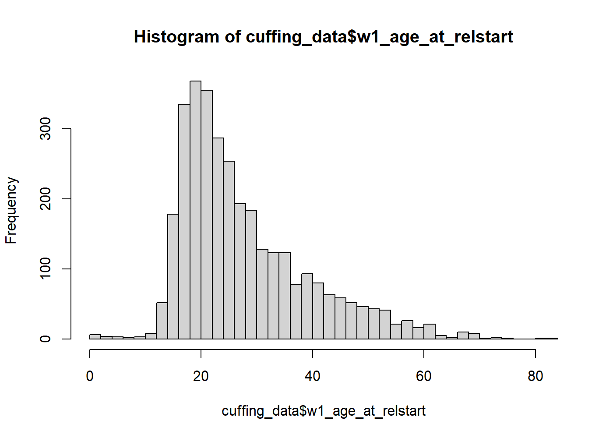

``` r
summary(cuffing_data$w1_q21e_year)
```

       Min. 1st Qu.  Median    Mean 3rd Qu.    Max.     NAs 
       1975    2002    2012    2008    2016    2017    3100 

``` r
sum(!is.na(cuffing_data$w1_q21e_year))
```

    [1] 410

``` r
ggplot(cuffing_data, aes(x = w1_age_when_met, y = w1_age_at_relstart)) +
  geom_point(alpha = 0.1)
```

    Warning: Removed 247 rows containing missing values or values outside the scale range
    (`geom_point()`).

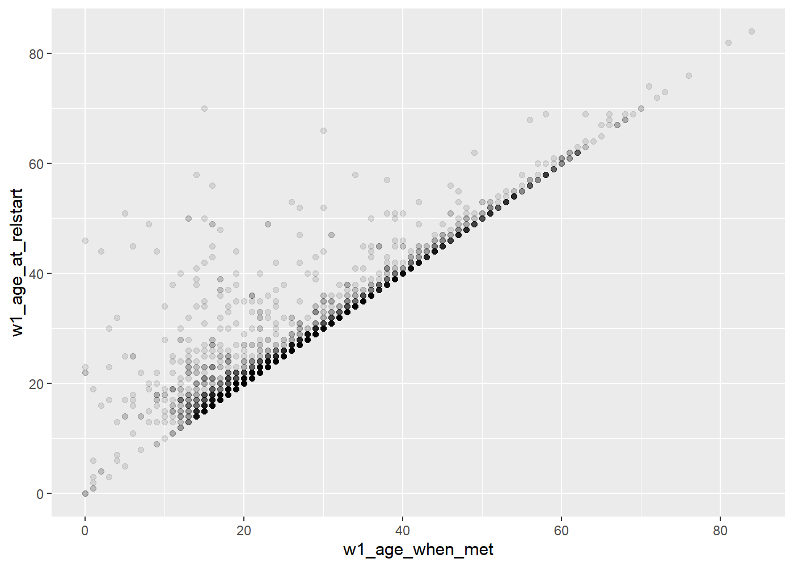

``` r
ggplot(cuffing_data, aes(x = met_season, y = w1_time_from_met_to_rel)) +
  geom_boxplot()
```

    Warning: Removed 247 rows containing non-finite outside the scale range
    (`stat_boxplot()`).

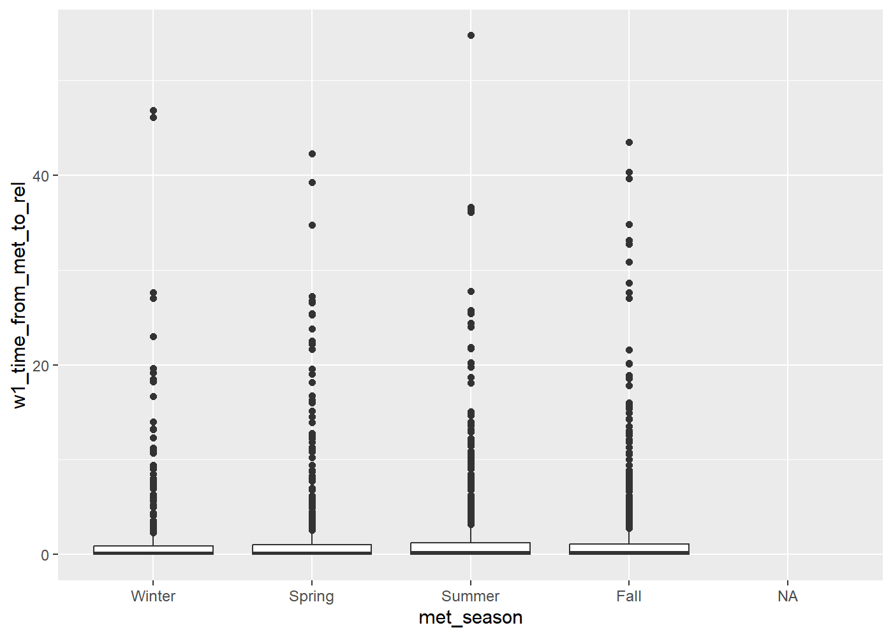

``` r
cuffing_design <- cuffing_data |>
  as_survey_design(
    ids = 1,
    weights = w1_weight_combo
  )

cuffing_grouped_summary <- cuffing_design |> 
  group_by(relstart_season, w1_age_at_relstart_cat) |> 
  summarize(count = survey_total()
  )

online_grouped_summary <- cuffing_design |> 
  group_by(relstart_season, w1_q24_met_online) |> 
  summarize(count = survey_total(),
            prop = survey_mean(proportion = TRUE))

ggplot(online_grouped_summary, aes(x = relstart_season, y = prop, fill = w1_q24_met_online)) +
  geom_col()
```

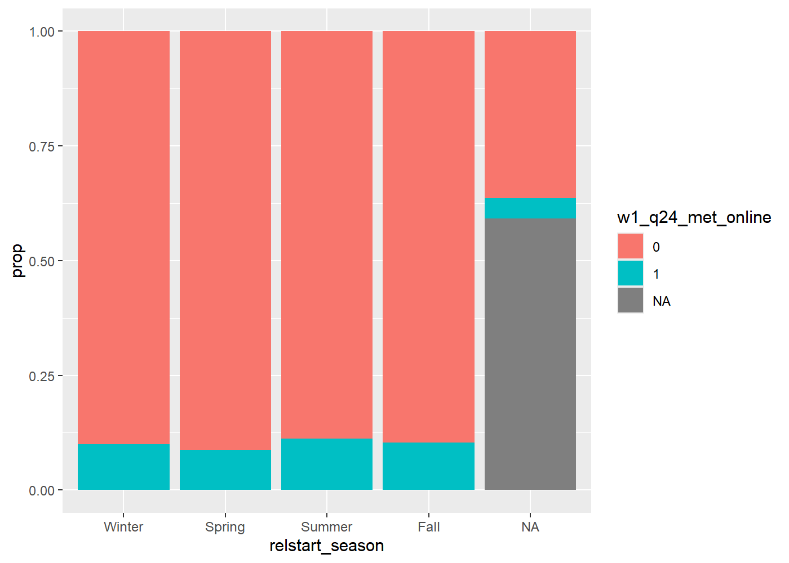

``` r
cuffing_success <- cuffing_data |> 
  group_by(relstart_season) |> 
  summarize(avg_relationship_length = mean(relationship_length, na.rm = TRUE),
            matches = sum(!is.na(relationship_length)),
            count = n()) |> 
  mutate(success_rate = matches/count)

ggplot(cuffing_success, aes(x = relstart_season, y = avg_relationship_length)) +
  geom_col()
```

    Warning: Removed 1 row containing missing values or values outside the scale range
    (`geom_col()`).

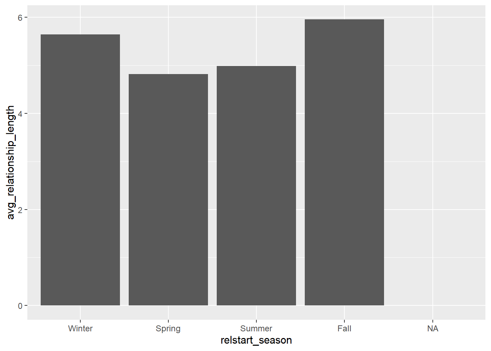

``` r
ggplot(cuffing_success, aes(x = relstart_season, y = success_rate)) +
  geom_col()
```

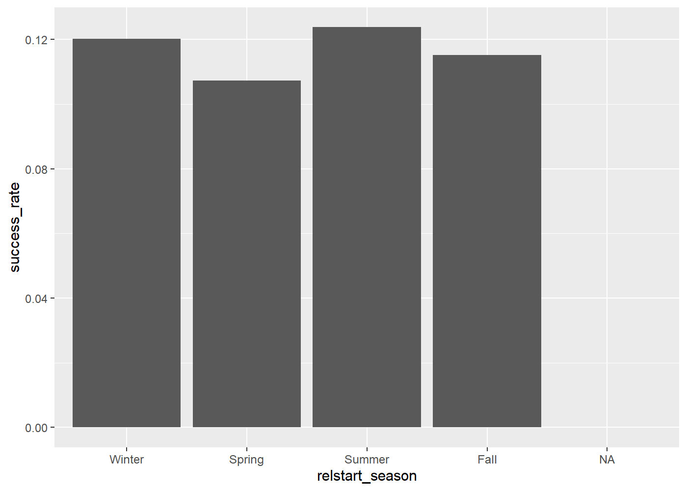

``` r
commitment_time <- cuffing_design |>
  filter(w1_q21a_year < 2017) |> 
  group_by(w1_q21a_month) |> 
  summarize(avg_time_to_commit = survey_mean(w1_time_from_met_to_rel, na.rm = TRUE, vartype = "ci"),
            count = survey_total())

ggplot(commitment_time, aes(x = w1_q21a_month, y = avg_time_to_commit)) +
  geom_col()
```

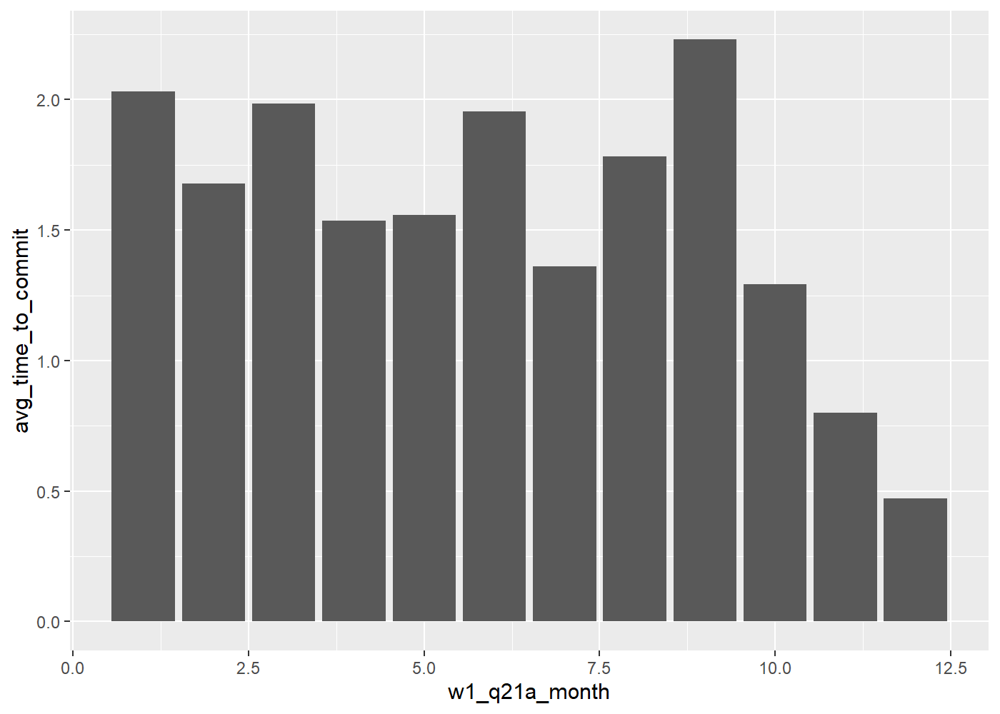

``` r
# ChatGPT was used for this chart to help me figure out how I could use srvyr data with this package. it let me know about ymin and ymax and using the vartype = "ci" from the survey_mean() arguments

ggplot(commitment_time,
       aes(
         x = w1_q21a_month,
         y = avg_time_to_commit,
         ymin = avg_time_to_commit_low,
         ymax = avg_time_to_commit_upp
       )) +
  ggdist::geom_lineribbon()
```

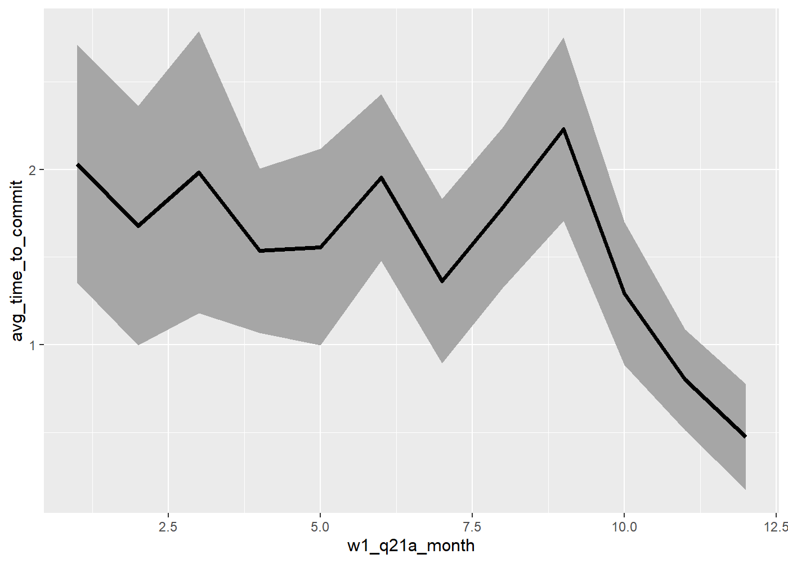

``` r
library(patchwork)

# seeing counts by age group categories for relationship start age since I had been ignoring <18 before on accident
ggplot(cuffing_data, aes(x = w1_age_at_relstart_cat)) +
  geom_bar()
```

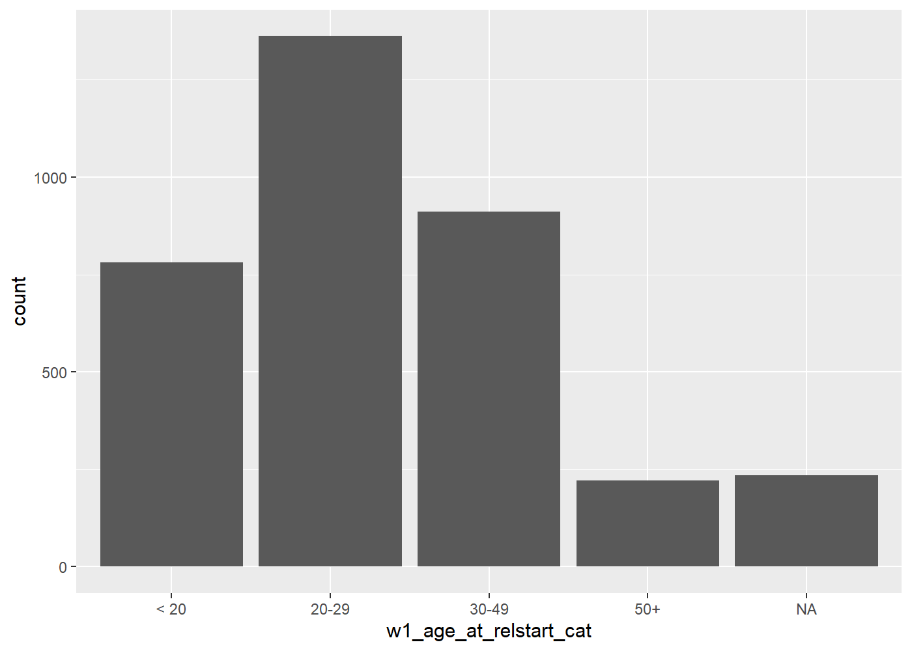

``` r
# this is what the histogram looks like before taking weights into account
ggplot(cuffing_data, aes(x = w1_q21b_month, fill = w1_age_at_relstart_cat)) +
  geom_bar()
```

    Warning: Removed 209 rows containing non-finite outside the scale range
    (`stat_count()`).

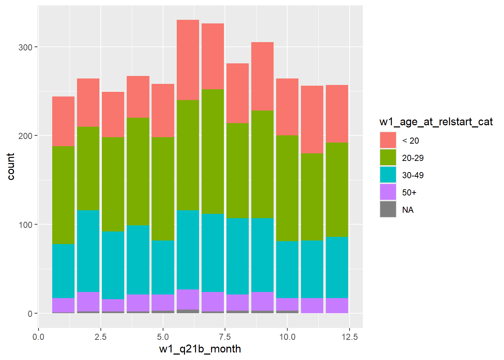

``` r
# this is what the seasonal chart looks like before taking weights into account
ggplot(cuffing_data, aes(x = met_season, fill = w1_age_at_relstart_cat)) +
         geom_bar()
```

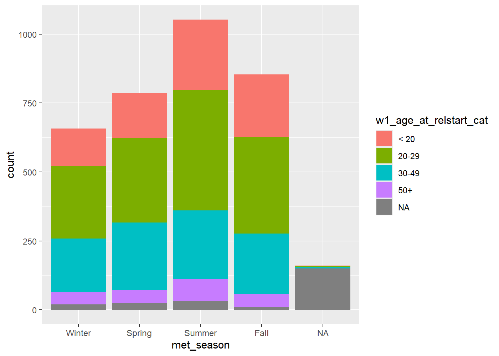

``` r
# only looking at the 18-24 category
all_age_met <- ggplot(cuffing_data, aes(x = met_season)) +
  geom_bar()  +
  ggtitle("Meet Date by Season, All Ages")

all_age_relstart <- ggplot(cuffing_data, aes(x = relstart_season)) +
  geom_bar() +
  ggtitle("Start Date by Season, All Ages")

# only looking at the 18-24 category
college_age_met <- ggplot(subset(cuffing_data, w1_age_at_relstart_cat == "< 20"), aes(x = met_season)) +
  geom_bar()  +
  ggtitle("Meet Date by Season, 18-24")

college_age_relstart <- ggplot(subset(cuffing_data, w1_age_at_relstart_cat == "< 20"), aes(x = relstart_season)) +
  geom_bar() +
  ggtitle("Start Date by Season, 18-24")

# plot these 4 to compare

(all_age_met + college_age_met) / (all_age_relstart + college_age_relstart)
```

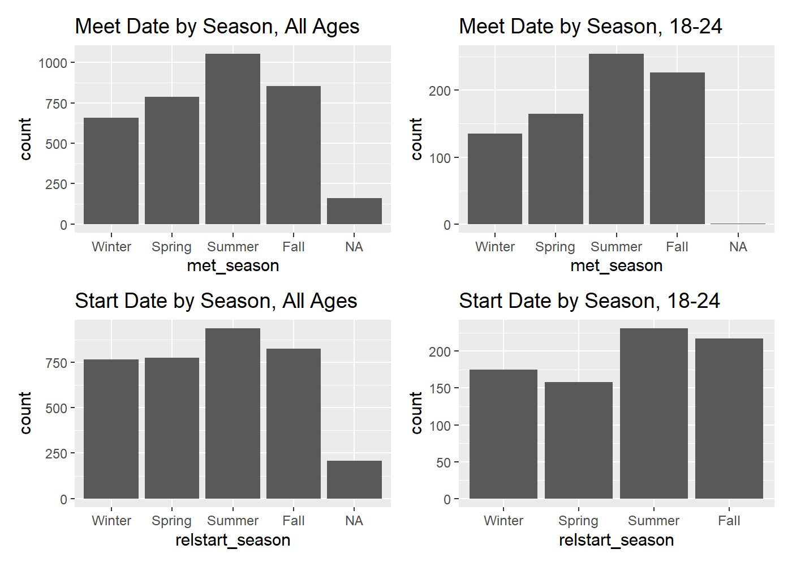

``` r
# trying out the waffle plot. seriously struggling with understanding how it works. may try to return to it...

ggplot(cuffing_grouped_summary, aes(fill=relstart_season, values=count)) +
  geom_waffle(
    color = "white", 
    size = 1,
    n_rows = 5,
    make_proportional = TRUE
  ) +
  facet_wrap(~w1_age_at_relstart_cat, ncol=1) +
  scale_x_discrete(
    expand = c(0,0,0,0)
  ) +
  scale_y_discrete(
    expand = c(0,0,0,0)
  ) +
  ggthemes::scale_fill_tableau(name=NULL) +
  coord_equal() +
  labs(
    title = "Faceted Waffle Geoms"
  )
```

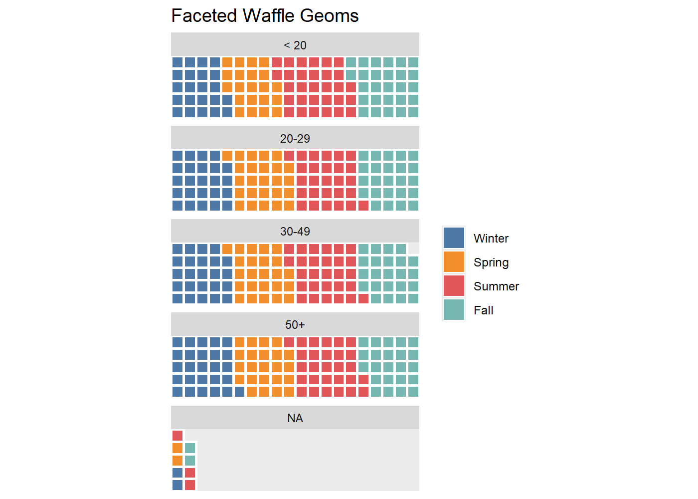
